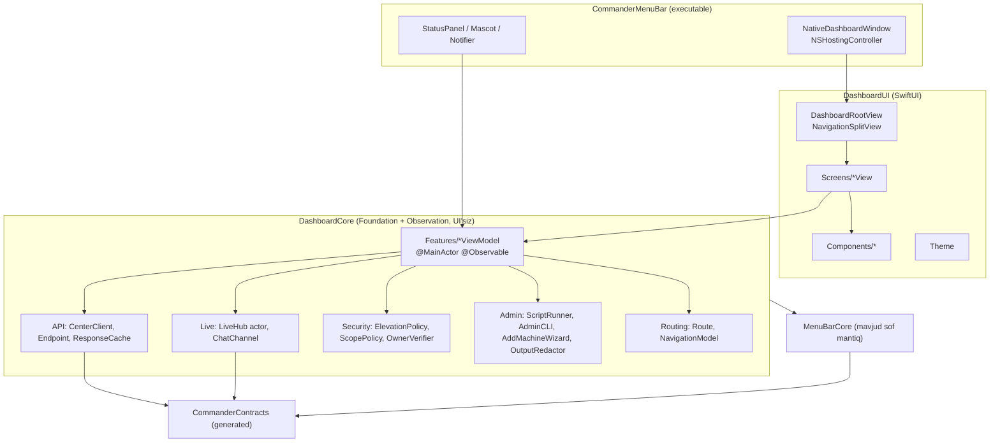

# Commander: Mac ilovasidagi "Dashboard" oynasini toʻliq native (SwiftUI) qilish

Bu hujjat alohida kod sessiyasi (oldingi suhbatni bilmaydigan model) uchun yozilgan: savol bermasdan bajarish uchun
kerakli hamma narsa shu yerda. Avval 1-3 va 6-8 boʻlimlarni toʻliq oʻqing, keyin 7-boʻlimdagi jadval boʻyicha
tartib bilan ishlang. Arxitektura qarorlari bu hujjatda; `docs/PLAN.md`ga ADR yozuvi Faza 0 da qoʻshiladi (N0.1).

Bogʻliq hujjatlar: `CLAUDE.md` (qatʼiy qoidalar 1-8), `docs/PLAN.md` (ADRʼlar: "Qarorlar (0.6)", "Qarorlar (2.3-2.7)",
"Qarorlar (4.1)", "Qarorlar (klient pairing)", "Qarorlar (4.2 ...)", "dashboard Mac ilovasi ichida (variant A)",
"ADR: dashboard lokal autentifikatsiya (H-01)"), `docs/TASKS.md` (jadval formati), `docs/DESIGN-BRIEF.md`
(holatlar, ranglar, matnlar), `docs/design/project/*.dc.html` (vizual namuna), `docs/add-server.md`,
`docs/remote-control.md`.

---

## 1. Maqsad va koʻlam

**Maqsad.** `apps/menubar` dagi "Commander" oynasi hozir `WKWebView` ichida Next.js dashboardʼni (`http://127.0.0.1:4318`)
ochadi (`Sources/CommanderMenuBar/DashboardWindow.swift`). Uni toʻliq native SwiftUI ilovaga almashtiramiz:
web dashboardʼning **har bir sahifasi va har bir funksiyasi** nativeʼda bir xil (yoki yaxshiroq) ishlashi shart.

**Nega.** (1) Web ilovada client-routing qotib qolishi (freeze) bor; (2) Mac ilova oʻzi markazga toʻgʻridan-toʻgʻri
ulangan (WS + Keychain token), oraliq Next.js server va uning `.env.local`dagi tokenlari kerak emas; (3) Touch ID,
bildirishnoma, Dock, klaviatura, lokal skriptlarni (mashina qoʻshish) ishga tushirish nativeʼda tabiiy.

**Koʻlam (hammasi majburiy, "keyinroq" yoʻq):**

1. Web dashboardʼning 23 sahifasi + `/usage` yoʻnaltirishi (4-boʻlim) va ulardagi barcha amallar (approve/deny, AskUserQuestion javobi, reja
   rad etish, prompt, stop, start, resume/close, Remote Control, deploy/rollback, checkpoint, git diff/PR/CI,
   byudjet, shablon, navbat, orkestratsiya, xabarlashuv, hisobot, hisob-kitob va eksport, xavfsizlik skani,
   sozlamalar sinxroni, umumiy sozlamalar, qidiruv/savol, yoʻriqnoma).
2. "Mashinalar" boʻlimida **"Mashina qoʻshish"** ustasi (wizard), nomini oʻzgartirish, olib tashlash, siyosatni koʻrish
   (5-boʻlim).
3. Hozir faqat CLI/skript bilan bajariladigan boshqaruv amallarining native ekvivalenti (5.6).
4. Kod sifati: rubrika boʻyicha har faza va har katta ekran **>= 9.5/10** (6-boʻlim).

P0/P1/P2 faqat **tartibni** belgilaydi. Oxirgi faza (Faza 4): paritet roʻyxati (har sahifa/amal) toʻliq yopilgach
`WKWebView` olib tashlanadi. Shungacha web koʻrinish sozlamada **zaxira** (fallback) boʻlib qoladi.
"Brauzerda ochish" tugmasi **doim qoladi** (web dashboard launchd xizmati `uz.commander.dashboard` oʻchirilmaydi).

**Koʻlamdan tashqari (aniq):** web dashboard kodini oʻzgartirish (faqat paritet uchun oʻqiladi), mobil ilova,
Telegram bot. Center/contracts/ops oʻzgarishlari faqat 5-boʻlimda sanab oʻtilgan yangi endpoint/CLI/skript ishlari.

---

## 2. Hozirgi holat (qayta ishlatiladigan qismlar)

### 2.1 `apps/menubar` (Swift 6, SwiftPM, macOS 14+)

`Package.swift`: targetlar `MenuBarCore` (sof mantiq, test bilan), `CommanderMenuBar` (executable), `MenuBarCoreTests`;
bogʻliqlik faqat `../../clients/swift/CommanderContracts`. `swiftLanguageModes: [.v6]`.

| Fayl | Nima | Native dashboardʼda taqdiri |
|---|---|---|
| `Sources/CommanderMenuBar/CommanderApp.swift` | `CommanderMain`: sof AppKit lifecycle, oʻz asosiy menyusi | Qoladi; "Koʻrinish" menyusiga ⌘1..9 va navigatsiya bandlari qoʻshiladi |
| `StatusPanel.swift`, `Views/PanelView.swift` (689 qator) | NSStatusItem + native panel | Qoladi; panel komponentlari umumiy `DashboardUI/Components`ga koʻchiriladi (DRY). PanelView 300 qatordan katta: tegilganda boʻlinadi (N0.12) |
| `AppModel.swift` (389) | `@MainActor @Observable` holat, WS, snapshot | Qoladi; WS va snapshot `LiveHub`ga koʻchadi, AppModel uning isteʼmolchisi boʻladi (N0.6) |
| `ClientSocket.swift` | `URLSessionWebSocketTask` `/ws/client` | `DashboardCore/Live`ga koʻchadi, protokol orqali DI |
| `Platform.swift` | `TokenStore` (Keychain), `AppSettings`, `DebugLog`, `LoginItem`, `DeviceInfo` | Qoladi; `TokenStore` protokol ortiga olinadi |
| `Notifier.swift` | Bildirishnomalar, chuqur havolalar | Qoladi; bosilganda native route ochadi |
| `DashboardWindow.swift` (529) | `NSWindow` + `WKWebView`, toolbar, ⌘ yorliqlar, "Dashboard ishlamayapti" | Faza 0 da `NativeDashboardWindow` (NSHostingController) qoʻshiladi; WKWebView qismi Faza 4 gacha zaxira, keyin oʻchiriladi |
| `DashboardAuthBridge.swift` | `commanderAuth` JS koʻprigi, `OwnerPresence.verify` (Touch ID), `AppSecretStore` | `OwnerPresence` native elevationʼda qayta ishlatiladi; JS koʻprik Faza 4 da oʻchadi |
| `Theme.swift`, `MascotView.swift`, `MascotPopup.swift` | Ranglar, Pill, PulsingDot, maskot | `Theme` `DashboardUI`ga koʻchadi (hamma joyda bitta manba) |
| `Views/SettingsView.swift`, `PairingView.swift`, `ApprovalCardView.swift` | Sozlamalar, ulash, ruxsat kartasi | Qoladi; ApprovalCardView umumiy komponentga aylanadi |
| `PreviewRenderer.swift` | `--render-previews <out> <fixtures>` PNG | Har yangi ekran shu yerga qoʻshiladi (`staticRender` naqshi) |
| `Sources/MenuBarCore/CenterAPI.swift` | REST (`me`, `snapshot`, `decide`, `revokeSelf`, `pair`), `ClientWire` | `DashboardCore/API` uchun asos; endpointʼlar katalogga koʻchadi |
| `MenuBarCore/DashboardLinks.swift` | `DashboardTarget` (overview, session, project, projectWork, machine, alerts, usage, queue) + `validID` | Kengaytiriladi: barcha 23 marshrut (3.4) |
| `MenuBarCore/{DashboardState,Summary,Formatting,PaceFormat,ApprovalFlow,QuestionFlow,Alerts,Reconnect,Pairing,DashboardAuth}.swift` | Sof mantiq, 76 test | Hammasi qayta ishlatiladi |

Yigʻish: `apps/menubar/scripts/build-app.sh [--install]` (Apple Development identity bilan imzo, `codesign --verify --strict`).
Debug log (ixtiyoriy): `defaults write uz.commander.menubar debugLog -bool YES` -> `~/Library/Logs/commander/menubar-debug.log`.
`ImageRenderer` `ScrollView`/`NSViewRepresentable`ni chiza olmaydi: preview uchun `staticRender` bayrogʻi bilan
statik variant chiziladi (mavjud naqsh).

### 2.2 Kontraktlar va kodgeneratsiya

- Manba: `libs/contracts/src/*.ts` (Zod 4). Swift tiplari **generatsiya qilinadi**: `npm run -w libs/contracts gen:schema`
  -> `clients/swift/CommanderContracts/Sources/CommanderContracts/Generated.swift` (+ `Helpers.swift`, `JSONValue.swift`).
  Drift tekshiruvi: `npm run -w libs/contracts gen:check` va `libs/contracts/tools/gen-check.spec.ts`.
- Yangi klient tipi kerak boʻlsa: `libs/contracts/tools/json-schema.ts` dagi `OUTPUT_ROOTS`/`INPUT_ROOTS`ga ildiz qoʻshiladi.
- Query-string sxemalari (`List*Query`) generatsiya qilinmaydi: URLʼni klient yigʻadi (`Endpoint` katalogi, 3.2).
- Fixtureʼlar: `clients/fixtures/*.json` (+ `ws/`), `clients/tools/capture-fixtures.mjs` (jonli centerʼdan, tozalangan).
  Yangi ekranlar uchun yetishmayotgan fixtureʼlar shu skript bilan qoʻshiladi (N0.4).
- Nomaʼlum enum: Swift `.unknown(String)`; WS union: `.unknown(type:raw:)` (yiqitmaydi).

### 2.3 Center (NestJS) yuzasi

- REST: `/v1/*`, `@ClientAuth(scope)`; scopeʼlar `read`, `approve`, `control`, `admin` (faqat `admin` hammasini qamraydi).
  Hozirgi menu-bar tokeni: `read,approve`. Native dashboard uchun **`read,approve,control`** kerak (N0.5). `admin`
  pairing orqali **hech qachon** berilmaydi (PLAN "klient pairing").
- WS: `/ws/client`, kanallar `sessions, machines, usage, limits, approvals, commands, projects, messages, health,
  queue, alerts, orchestrations` (`libs/contracts/src/client-protocol.ts` `CLIENT_CHANNELS`). Server xabarlari:
  `session.updated, machine.updated, usage.tick, limits.updated, approval.created, approval.resolved, command.updated,
  project.updated, message.created, message.updated, alert.created, alert.updated, machine.health, queue.updated,
  orchestration.updated, lockdown.updated`. Chat: klient `chat.open {sessionId, before?, limit?}` / `chat.close`,
  server `chat.items`, `chat.state`, `chat.error` (`libs/contracts/src/chat.ts`).
- Buyruqlar: `POST /v1/commands` (`control`), turlar `libs/contracts/src/commands.ts` `COMMAND_TYPES`
  (`session.start|prompt|stop|set_mode|remote_control|resume|close`, `project.*`, `config.*`, `logs.tail`,
  `assistant.ask`, deploy va checkpoint turlari). Holatlar `awaiting_confirmation -> pending -> sent -> acked ->
  running -> done|failed|expired|rejected`. Telegram step-up qarorini **markaz** qiladi (`commands/control-logic.ts`
  `needsStepUp`, `commands/config-precheck.ts`); klient faqat `awaiting_confirmation` holatini koʻrsatadi.
- Lockdown: oʻzgartiruvchi soʻrovlar 403 `lockdown` (istisno `@LockdownExempt`: deny, dismiss, archive, cancel...).
- Admin yuzasi **faqat CLI** (ADR 0.6): `ops/mac/commander-admin.sh` -> konteyner ichida `node dist/cli.js`
  (`apps/center/src/cli/commands.ts`): `enroll-code create|list`, `token create|list|revoke|rotate`, `client pair`,
  `device list|revoke|require-rotation`, `lockdown on|off|status`, `telegram pending|allow|remove|list`,
  `center-key show|rotate`, `retention status`, `audit verify`.

### 2.4 Web dashboard (paritet manbai)

`apps/dashboard/app/(app)/**/page.tsx` -> `components/**` -> `lib/client-api.ts` (`/api/c/<v1 yo'l>` proksi) va
`lib/commander.ts` (SSR, `${apiUrl}/v1${path}`). Jonli: `lib/live-client.ts` (SSE `/api/stream`), `lib/bridge.ts`
(server tomonda `/ws/client`), `lib/chat-bridge.ts` (`/api/chat/<id>/stream|older`). Koʻtarilish (elevation)
qoidalari: `lib/proxy-rules.ts` `elevationFor/elevationRequired` (fail-closed). Matn/format mantiqi: `lib/*-view.ts`,
`lib/*-ui.ts`, `lib/*-errors.ts` (xato kodlari -> oʻzbekcha matn) — nativeʼda shu jadvallar **aynan** koʻchiriladi.

---

## 3. Arxitektura

### 3.1 Qatlamlar va SwiftPM targetlari

- **`DashboardCore`** (yangi target): `import SwiftUI`/`AppKit` **taqiqlangan** (N0.2 dagi `scripts/check-layers.sh`
  grep bilan tekshiradi). Tarkibi: `API/`, `Live/`, `Routing/`, `Security/`, `Admin/`, `Features/<Ekran>/`
  (view model + sof reduktor/formatlovchi), `Support/` (Clock, Debounce). Testlari `DashboardCoreTests`.
- **`DashboardUI`** (yangi target): faqat SwiftUI koʻrinishlar va `Theme`. Tarmoq chaqiruvi yoʻq; view modelʼni
  init orqali oladi. `Components/` (qayta ishlatiladigan), `Screens/<Ekran>/`, `Shell/`.
- **`CommanderMenuBar`**: oyna, panel, ilova hayot sikli, DI kompozitsiya ildizi (`AppEnvironment`).
- **DI**: har servis protokol: `CenterAPIClient`, `LiveUpdates`, `TokenProviding`, `OwnerVerifying`, `ScriptRunning`,
  `ClockProviding`, `FileExporting`. Ishlab chiqarish implementatsiyasi `AppEnvironment.live`, testda fake.
  Singleton/global holat yoʻq (mavjud `TokenStore` enumʼi protokol adapteri bilan oʻraladi).

### 3.2 API klient

- `Endpoint<Response>`: metod, yoʻl segmentlari, query, tana (`Encodable` generated tip), kerakli scope, elevation
  turi (3.6), idempotentlik. Barcha endpointʼlar bitta katalogda: `DashboardCore/API/Endpoints+<Soha>.swift`
  (soha boʻyicha fayllar, har biri <= 300 qator). Yoʻl satrlari faqat shu katalogda (magik satr qoidasi).
- `CenterClient` (`actor` yoki `Sendable struct` + `URLSession`): `Authorization: Bearer <token>` (Keychainʼdan,
  `TokenProviding`), JSON dekod generated tiplarga, xatolar -> `APIError` (`unauthorized`, `forbidden(code)`,
  `lockdown`, `insufficientScope`, `conflict(code)`, `validation(code)`, `rateLimited(retryAfter)`, `server`,
  `offline`, `decoding`). Xato kodi (`{code}` tanadan) -> oʻzbekcha matn: `ErrorText` jadvali (web
  `lib/*-errors.ts`, `lib/control-ui.ts` bilan bir xil matnlar; jadval testi bor).
- 401 -> qayta pairing oqimi (mavjud `CloseDecision` mantiqi); 429 -> `Retry-After` hurmat qilinadi.
- **Sahifalash**: center `limit` (+ `before`/kursor bor joyda) parametrlari; roʻyxatlar `PagedLoader<T>` bilan
  (oxiriga yetganda keyingi sahifa, takroriy soʻrov bloklanadi). Web qaysi `limit` ishlatsa, boshlangʻich qiymat shu.
- **Kesh**: `ResponseCache` (xotirada, kalit = endpoint + query): stale-while-revalidate; TTL roʻyxatlar 30 s,
  sozlamalar 5 daqiqa (konstantalar `CacheTTL`da). Jonli hodisalar keshni **yamaydi** (reduktor), qayta soʻrov emas.
  Disk keshi yoʻq (maxfiylik). Chiqishda (unpair) kesh tozalanadi.
- Eksport/yuklab olish (timesheet XLSX/CSV/PDF, mijoz hisoboti): `FileExporting` -> `NSSavePanel`; fayl tizim
  vaqtinchalik papkasiga emas, foydalanuvchi tanlagan joyga.

### 3.3 Jonli kanallar (`LiveHub`)

- Bitta `/ws/client` ulanishi butun ilova uchun (panel + oyna). `LiveHub` (`actor`): `auth` -> `subscribe` (kerakli
  kanallar, ekranlar talab qilganda dinamik `subscribe/unsubscribe`, ref-count) -> `AsyncStream<ServerToClientMessage>`
  har isteʼmolchiga. Qayta ulanish mavjud `ReconnectPolicy` (1 s -> 60 s, ±20% jitter, 4001/4010 toʻxtaydi).
- Ulanish tiklanganda: obuna qilingan kanallar uchun REST snapshot qayta olinadi (PLAN §8 tartibi: subscribe -> snapshot).
- Chat: `ChatChannel` (`chat.open {sessionId, limit}` -> `chat.items` backfill -> `chat.state live` -> qoʻshimchalar;
  eski sahifa `chat.open {before: cursor}` -> `chat.items {older:true}`; ekran yopilsa `chat.close`).
  Web `lib/chat-bridge.ts`, `lib/chat-map.ts`, `lib/chat-format.ts` mantiqi `DashboardCore/Features/Session/Chat*`ga
  koʻchadi (sof funksiyalar, testlar fixture `clients/fixtures/ws/` bilan).
- Soʻrov asosidagi oqimlar (WSʼda yoʻq): log `GET /v1/logs/:commandId?after=`, deploy chiqishi
  `GET /v1/deploy/runs/:commandId/output?after=` — `PollingStream` (1 s, ekran koʻrinmasa toʻxtaydi, `DELETE /v1/logs/:id`
  ekran yopilganda).
- Ulanish holati UIʼda: "Jonli" (yashil nuqta) / "Qayta ulanmoqda…" / "Aloqa yoʻq" (DESIGN-BRIEF §4 "Ulanish").

### 3.4 Navigatsiya, marshrutlar, chuqur havolalar

- Oyna: `NSWindow` + `NSHostingController(rootView: DashboardRootView)`, `sceneBridgingOptions = [.toolbars, .title]`
  (macOS 14). `setFrameAutosaveName` saqlanadi; Dock/activation policy mantiqi (`ActivationPolicyState`) oʻzgarmaydi.
- `DashboardRootView`: `NavigationSplitView` (sidebar + detail). Detail ichida `NavigationStack(path:)`.
- `Route` (`DashboardCore/Routing`), mavjud `DashboardTarget`ning kengaytmasi (eski caseʼlar va `path`/`init(path:)`
  saqlanadi, testlar oʻzgarmaydi):

| Sidebar (tartib = ⌘1..9) | Route | Web yoʻli |
|---|---|---|
| ⌘1 Umumiy | `.overview` | `/` |
| ⌘2 Sessiyalar | `.sessions`, `.session(id)` | `/sessions`, `/sessions/[id]` |
| ⌘3 Loyihalar | `.projects`, `.project(id)`, `.projectWork(id)` | `/projects`, `/projects/[id]`, `/projects/[id]/work` |
| ⌘4 Mashinalar | `.machines`, `.machine(id)`, `.addMachine` | `/machines`, `/machines/[id]` |
| ⌘5 Ogohlantirishlar | `.alerts` | `/alerts` |
| ⌘6 Navbat | `.queue` | `/queue` |
| ⌘7 Tokenlar | `.tokens` (`.usage` alias) | `/tokens` (`/usage` -> `/tokens`) |
| ⌘8 Qidiruv | `.search` | `/search` |
| ⌘9 Shablonlar | `.templates` | `/templates` |
| — Hisobotlar | `.reports`, `.report(id)` | `/reports`, `/reports/[id]` |
| — Hisob-kitob | `.billing` | `/billing` |
| — Xavfsizlik | `.security`, `.scan(id)` | `/security`, `/security/[scanId]` |
| — Byudjetlar | `.budgets` | `/budgets` |
| — Umumiy sozlamalar | `.settings` | `/settings` |
| — Sozlamalar sinxroni | `.settingsSync` | `/settings-sync` |
| — Boshqaruv (yangi) | `.admin` | yoʻq (CLI ekvivalenti, 5.6) |
| — Yoʻriqnoma | `.help`, `.helpDoc(slug)` | `/help`, `/help/[slug]` |

- Id validatsiyasi: mavjud `DashboardTarget.validID` (`[A-Za-z0-9_-]{1,128}`); `slug` faqat maʼlum roʻyxatdan
  (`remote-control`, `add-server`, web `lib/help-docs.ts` bilan bir xil).
- Chuqur havola: bildirishnoma/maskot/panel `userInfo` yoʻli -> `Route(path:)` -> native oynada ochiladi
  (native rejimda), web rejimda eski xatti-harakat.
- Tarix: `NavigationModel` (orqaga/oldinga steklar): ⌘[ / ⌘]; toolbar tugmalari.
- Hali native boʻlmagan marshrut (oʻtish davri): detailʼda "Bu boʻlim hali native emas" + "Web koʻrinishda ochish"
  (WKWebView oynasida shu yoʻl) + "Brauzerda ochish". Faza 4 da bu holat yoʻqolishi shart (paritet testi).

### 3.5 Holatlar, UI qoidalari, a11y

- Har ekran `LoadState<T>`: `.idle`, `.loading`, `.loaded(T)`, `.empty(reason)`, `.failed(UserFacingError)`;
  umumiy `LoadStateView` komponenti (skeleton, boʻsh holat matni, xato + "Qayta urinish"). Qisman xato (masalan
  alerts olinmadi) butun ekranni boʻshatmaydi (mavjud panel qoidasi).
- Lockdown: `lockdown.updated` -> tepada qizil banner "Lockdown yoqiq: masofadan faqat rad etish mumkin"; ruxsat
  berish va boshqa oʻzgartirishlar oʻchadi, deny/stop/cancel ishlaydi.
- Limitlar: **doim** `source` bilan; `estimate` -> "≈" + xira/shtrix uslub + "taxmin" yorligʻi; `stale` -> "N oldin
  kuzatilgan"; 80% sariq, 95% qizil (CLAUDE.md #6, DESIGN-BRIEF §4). Mavjud `LimitFormat`/`PaceFormat` ishlatiladi.
- `[REDACTED]` joylarni ochish tugmasi yoʻq; tool input faqat markaz bergan redakt qilingan koʻrinish.
- Mavzu: yorug'/qorongʻi toʻliq (`Theme` dinamik ranglari). Har ekran preview ikkala rejimda chiziladi.
- Yorliqlar: ⌘1..9 (sidebar), ⌘F (joriy roʻyxat qidiruvi `.searchable` fokus; Qidiruv sahifasida soʻrov maydoni),
  ⌘R (joriy ekranni yangilash), ⌘[ / ⌘] (tarix), ⌘N (yangi sessiya), ⌘W (oyna), ⌘, (sozlamalar); ruxsat kartasida
  `A` ruxsat (tasdiq bilan), `D` rad (DESIGN-BRIEF §6). Yorliqlar asosiy menyuda (`CommanderApp.swift`) va
  `.keyboardShortcut` bilan; accessory rejimda `NSWindow.performKeyEquivalent` zaxirasi (mavjud naqsh).
- Accessibility: har interaktiv element `accessibilityLabel` (oʻzbekcha), holat rangi yolgʻiz maʼlumot tashuvchi
  emas (matn/ikonka ham), Dynamic Type oʻrniga `.font(.body)` shkalasi, VoiceOver tartibi mantiqiy, Reduce Motionʼda
  animatsiyalar oʻchadi (maskotdagi kabi).
- UI matnlari oʻzbekcha (lotin), texnik nomlar (model, tool, fayl yoʻli) asl holida. Matnlar `Strings` (soha boʻyicha
  enumʼlar) ichida, View ichida tarqoq satr yoʻq (takrorlanadigan va xato matnlari uchun majburiy).

### 3.6 Xavfsizlik modeli (native)

1. **Token**: Keychain (`TokenStore`, `kSecAttrAccessibleAfterFirstUnlockThisDeviceOnly`). Logga, xato matniga,
   `DebugLog`ga hech qachon yozilmaydi. `CenterClient` soʻrov tanasi/sarlavhalarini loglamaydi.
2. **Scope**: `ScopePolicy` — `GET /v1/devices/me` dagi scopeʼlar boʻyicha UI tugmalarini yashiradi/oʻchiradi
   (`approve` yoʻq -> ruxsat tugmalari yoʻq; `control` yoʻq -> boshqaruv tugmalari "Ruxsat yoʻq: control scope").
3. **Lokal koʻtarilish (elevation, "E")**: webʼdagi H-01 himoyasining native ekvivalenti. `ElevationPolicy` =
   `apps/dashboard/lib/proxy-rules.ts` `elevationFor/elevationRequired` ning **aynan** koʻchirmasi (fail-closed:
   oʻzgartiruvchi har soʻrov elevation talab qiladi, ochiq istisnolar: approval deny, `session.stop`, bekor qilish
   (command/queue/orchestration), avto-ruxsat qoidasini revoke, alert dismiss, shablon render/CRUD, faqat oʻqiydigan
   git/CI/refresh buyruqlari, kanban holati, navbat elementini oʻchirish). Talab qilinsa `OwnerVerifier`
   (`OwnerPresence.verify`, Touch ID yoki tizim paroli; parolsiz Macʼda fail-closed) -> 5 daqiqalik oyna
   (`ElevationWindow`, konstanta). Jadval testi: web `proxy-rules` testidagi har holat Swift testida takrorlanadi.
4. **Markaz step-up ("T")**: `session.start`, `set_mode acceptEdits|auto`, `auto` rejim, Remote Control yoqish,
   `config.apply` (dry-run emas), deploy turlari — markaz Telegram ikkinchi tasdigʻini soʻraydi (qurilma
   `commands.stepup_exempt_device_ids`da boʻlmasa; `auto` va deploy hech qachon istisno emas). Klient
   `awaiting_confirmation` holatida "Telegramʼda tasdiqlang" koʻrsatadi; **hech qachon** avto-tasdiq yoʻq.
5. **Audit**: har masofaviy amal markazda `commands` + `audit_log` orqali (klient alohida yozmaydi). Lokal admin amallar
   (CLI) center CLIʼning oʻz audit yozuvlari bilan; native ilova qoʻshimcha `~/Library/Logs/commander/admin-actions.log`
   (0600, JSON qator: vaqt, amal, natija; sirlar/kodlar/tokenlarsiz) yozadi.
6. **Idempotentlik**: oʻzgartiruvchi buyruqlarga `Idempotency-Key` (UUID, qayta urinishda oʻsha kalit) — web
   `needsIdempotencyKey` qoidasi bilan bir xil.

### 3.7 Markdown

`MarkdownView`: blok darajasidagi renderer (sarlavha, roʻyxat, kod bloki, jadval, iqtibos, havola) —
`apple/swift-markdown` paketi (SwiftPM bogʻliqligi, aniq versiyaga qotiriladi) bilan parse qilinadi; AST -> koʻrinish
modeli `DashboardCore/Markdown` da (testlar bilan), chizish `DashboardUI` da (9-boʻlim, 1-qaror). Inline uchun `AttributedString(markdown:)`. Havolalar faqat `http(s)` (tizim
brauzerida) va ichki `/help/*`, `/sessions/*` va h.k. marshrutlar (`Route(path:)`).

---

## 4. Ekranlar spetsifikatsiyasi

Belgilar: **Scope** = token scopeʼi; **E** = lokal Touch ID koʻtarilish (3.6/3); **T** = markaz Telegram step-up
(3.6/4); **L** = lockdownʼda ham ishlaydi. Manbalar `/v1` prefiksisiz yozilgan. Har ekran uchun web manba fayli
paritet uchun koʻrsatilgan: native ekran shu fayl va u import qiladigan komponentlardagi **hamma** koʻrinadigan
maʼlumot va amalni qamrashi shart.

### 4.1 Umumiy — `.overview` (P0)

- Web: `components/overview/OverviewView.tsx` (+ `AlertsCard`, `ApprovalCard`, `BudgetBar`, `LimitsCard`,
  `MachineCard`, `HealthStrip`, `CenterHealthCard`, `CommandReviewPanel`, `NewSessionButton`).
- Manba: `GET sessions`, `GET machines`, `GET projects`, `GET usage/summary`, `GET limits`, `GET approvals?recentLimit=10`,
  `GET alerts?state=open&limit=50`, `GET health/summary`, `GET center/health`, `GET budgets`,
  `GET commands?status=awaiting_confirmation&limit=20`, `GET tasks?from=<bugun 00:00 Toshkent>&to=<hozir>&limit=..`.
  WS: `sessions, machines, usage, limits, approvals, alerts, health, commands, queue`.
- UI (DESIGN-BRIEF §3.1 tartibi): lockdown banneri; "Diqqat talab qiladi" (ruxsat kutayotgan kartalar taymer bilan,
  javob kutayotgan sessiyalar, tasdiq kutayotgan buyruqlar); limitlar (5 soat, haftalik, pace chizigʻi, teskari sanoq);
  tokenlar (Bugun / 7 kun / 30 kun / Jami, "≈ $X API ekvivalenti"); byudjet chiziqlari; mashina kartalari (OS ikonka,
  onlayn nuqta, holatlar boʻyicha sessiya soni, salomatlik chizigʻi); aktiv sessiyalar (5 ta + "Hammasi →");
  bugungi top-5 loyiha; ochiq ogohlantirishlar; markaz salomatligi; bugungi vazifalar.
- Amallar: ruxsat Allow (`approve`, E) / Deny (`approve`, L) — `POST approvals/:id/decision`; savol (AskUserQuestion)
  javobi va reja "Fikr bilan rad" (4.3 dagi bilan bir xil komponent); buyruqni tasdiqlash `POST commands/:id/confirm`
  (`approve`, E) / bekor `POST commands/:id/cancel` (`control`, L); alert dismiss `POST alerts/:id/dismiss`
  (`control`, L); "+ Yangi sessiya" (4.4).

### 4.2 Sessiyalar — `.sessions` (P0)

- Web: `components/sessions/SessionsView.tsx`, `lib/sessions-view.ts`, `lib/session-list.ts`.
- Manba: `GET sessions?limit=500` (+ `q`, `project` filtrlari), WS `sessions, approvals, machines`.
- UI: `Table` (holat, loyiha, mashina, model, holat davomiyligi, oxirgi xabar, ruxsat soni belgisi, tur:
  terminal/tmux/fon); filtrlar: holat, mashina, loyiha, matn (⌘F), "tugaganlarini ham"; oflayn mashina sessiyasi
  kulrang + ⚠ "Aloqa yoʻq". Saralash ustun boʻyicha. Qator -> `.session(id)`. `LazyVStack`/`Table` (lazy).
- Amallar: qator kontekst menyusi: "Toʻxtatish" (`control`, L), "Davom ettirish"/"Yopish" (4.3 qoidalari).

### 4.3 Sessiya sahifasi — `.session(id)` (P0, eng muhim ekran)

- Web: `components/sessions/SessionView.tsx` (+ `ApprovalCard`, `rules/ApprovalRulesPanel`, `intelligence/SummaryCard`,
  `chat/ChatStream`, `chat/PromptBox`, `TaskPill`, `control/{CommandProgress,ResumeButton,SessionExtraActions,useControl}`,
  `git/{DiffPanel,OpenPrDialog}`), `lib/{chat-*,control-ui,resume-ui,rc-ui,permission-mode,question-ui,session-approvals,session-history}.ts`.
- Manba: `GET sessions/:id`, `GET sessions/:id/events?limit=100`, `GET sessions/:id/commands`, `GET sessions/:id/summary`,
  `GET approval-rules?sessionId=..`, `GET approvals` (sessiya boʻyicha filtr), WS `sessions, approvals, commands`
  + chat (`chat.open/close`).
- UI: sarlavha (loyiha, mashina, model, holat pill, boshlangan vaqt, `permission_mode`, tur, Remote Control holati,
  vazifa (`TaskPill`)); markazda chat oqimi (foydalanuvchi promptlari, Claude javobi markdown, tool bloklari yigʻilgan
  `Bash: npm test` / `Edit: path (+12 −3)`, xatolar, har javob ostida token; yangi elementlar jonli, pastga avtomatik
  surish faqat foydalanuvchi pastda boʻlsa; yuqoriga surilganda eski sahifa yuklanadi); chat ichida ruxsat kartasi;
  pastda prompt maydoni (`controllable=false` boʻlsa oʻchiq va `controlReason` matni: `machine_offline`,
  `policy_disabled`, `interactive` = "terminal sessiyasi, faqat koʻrish (tmux ichida oching)", `session_ended`,
  `prompt_not_allowed`, `agent_not_ready`, `agent_outdated`); oʻng panel: sessiya tokenlari, holat tarixi (vaqt
  chizigʻi, events), buyruqlar tarixi (`CommandProgress`), AI xulosa, avto-ruxsat qoidalari, git diff.
- Amallar (`POST commands` bilan, `control`):
  - prompt `session.prompt {sessionId, text}` (E; `session_busy` xatosi matni); toʻxtatish `session.stop` (L, E yoʻq);
  - davom ettirish `session.resume`, yopish `session.close` (E; web `resume-ui.ts` shartlari: tugagan terminal
    sessiya, mashina onlayn, tmux bor);
  - Remote Control yoqish/oʻchirish `session.remote_control` (E, yoqish T);
  - rejim: faqat koʻrsatiladi (`set_mode` qoʻllab-quvvatlanmaydi: `set_mode_unsupported`, PLAN 2.3-2.7);
  - ruxsat: Allow (E) / Deny (L) / reja (`kind: plan`): "Rad" + "Fikr bilan rad" (<= 1000 belgi), Ruxsat tugmasi YOʻQ;
    savol (`kind: question`): variantlar (tavsiya belgisi), multiSelect, "Boshqa" erkin matn, bir nechta savol; javob
    `allow` + `answers` (mavjud `QuestionFlow`); 409 `approval_conflict|approval_expired` -> "Allaqachon hal qilingan…";
  - avto-ruxsat qoidasi yaratish `POST approval-rules` (E) / bekor `DELETE approval-rules/:id` (L);
  - diff `POST sessions/:id/diff` (E yoʻq, faqat oʻqish), PR ochish `POST projects/:id/pr` (E);
  - buyruq bekor `POST commands/:id/cancel` (L).

### 4.4 Yangi sessiya oynasi — sheet (P0)

- Web: `components/shell/{NewSessionButton,NewSessionModal}.tsx`, `components/control/OpenSessionButton.tsx`,
  `components/templates/TemplatePicker.tsx`.
- Maydonlar: mashina (faqat onlayn + `control.enabled && allowStart && centerKeyPinned && !runningAsRoot`),
  papka (mashina loyihalari, oxirgi ishlatilgani birinchi, yoki qoʻlda), vazifa matni (shablondan toʻldirish
  `POST templates/:id/render`), model, ruxsat rejimi (`default|acceptEdits|plan|auto`; `auto` faqat `allowAutoMode`),
  nom, "Remote Control bilan ochish".
- Amal: `POST commands {type: session.start, ...}` (`control`, E, T). Keyin `command.updated` boʻyicha holat:
  "Telegramʼda tasdiqlang" -> "Yuborildi" -> "Bajarilmoqda" -> yangi sessiyaga oʻtish (`result.sessionId`).
  Xato kodlari `lib/control-ui.ts` matnlari bilan.

### 4.5 Loyihalar — `.projects` (P1)

- Web: `components/projects/ProjectsView.tsx`, `lib/projects-view.ts`, `useArchiveProject.ts`.
- Manba: `GET projects?limit=500`, arxiv `GET projects?archived=1&limit=500`, `GET sessions`; WS `projects, usage, sessions`.
- UI: jadval (loyiha, mashina, bugun/jami token, soʻrovlar, ochiq sessiyalar, oxirgi ishlatilgan; saralanadi), "Arxiv"
  filtri, qismlar progressi (`PartsProgressCard`).
- Amallar: arxivlash/qaytarish `POST projects/:id/archive|unarchive` (`control`, E, L).

### 4.6 Loyiha sahifasi — `.project(id)` (P1)

- Web: `components/projects/{ProjectDetailView,TasksSection,PartsProgressCard}.tsx`, `git/{GitSection,TaskGit,useGit}`,
  `intelligence/DecisionsSection`, `checkpoints/CheckpointsSection`, `deploy/*`, `budgets/BudgetBar`, `CommitList`,
  `MarkdownView`, `charts/BarChart`, `control/{OpenSessionButton,ResumeButton,SessionQuickActions}`.
- Manba: `GET projects/:id`, `GET projects/:id/tasks`, `GET projects/:id/commits`, `GET projects/:id/parts`,
  `GET projects/:id/git`, `GET projects/:id/decisions`, `GET projects/:id/deploy/runs`, `GET checkpoints/settings`,
  `GET projects/:id/scans`, `GET usage?projectId=..` (30 kun), `GET sessions?project=:id&limit=50`, `GET budgets`.
- UI: 30 kunlik token grafigi (Swift Charts), sessiyalar, commitlar, `TODOS.md`/`CHANGELOG.md` (markdown),
  TASKS.md vazifalari (bajarildi/jarayonda/qoldi, progress, vazifa boʻyicha token/vaqt), qismlar, git holati + CI,
  qarorlar jurnali, checkpointʼlar, deploy boʻlimi (maqsad kartasi, inspect xulosasi, tarix, jonli chiqish), skan
  natijalari havolasi, byudjet.
- Amallar: yangilash `POST projects/:id/refresh` (E yoʻq); diff `POST projects/:id/diff`; PR `POST projects/:id/pr` (E);
  CI yangilash `POST projects/:id/ci/refresh`; qaror qoʻshish/tahrir `POST projects/:id/decisions`,
  `PATCH decisions/:id` (E); checkpoint yaratish/roʻyxat/qaytarish `POST projects/:id/checkpoints`,
  `.../checkpoints/list`, `.../checkpoints/restore` (restore: E, T mumkin); deploy `POST projects/:id/deploy/inspect`,
  `.../deploy/run`, `.../deploy/rollback` (E, T, `commands/:id/confirm` oqimi `DeployConfirm`); skan
  `POST projects/:id/scan` (E); sessiya ochish (4.4 oldindan toʻldirilgan), davom ettirish; arxivlash.

### 4.7 Loyiha ish maydoni — `.projectWork(id)` (P1)

- Web: `components/work/{WorkView,BoardTab,DailyTab,MdImportDialog,MessagingPanel,PartsPanel,SessionsPanel,useMessaging,useWorkApi}`,
  `queue/{QueueFormDialog,useQueue}`, `orchestration/OrchestrationPanel`, `rules/ApprovalRulesPanel`, `lib/work-view.ts`,
  `lib/messaging-view.ts`, `lib/orchestration-view.ts`, `lib/parts-view.ts`.
- Manba: `GET projects/:id`, `/tasks`, `/parts`, `/daily?from&to[&part]`, `/md-files`; `GET messaging/{settings,groups,group,messages,links}`;
  `GET orchestrations?projectId=..&limit=30`, `GET orchestrations/:id`; `GET queue`; WS `projects, messages, orchestrations, queue, sessions, commands`.
- UI: doska (Qoldi -> Jarayonda -> Tekshiruvda -> Bajarildi; drag-and-drop), kunlik koʻrinish (reja vs haqiqiy,
  AI kun xulosasi va baho, qism boʻyicha), `.md` dan vazifa ajratish dialogi, qismlar, sessiyalar paneli,
  xabarlashuv (guruhlar, rollar, bogʻlashlar, qoidalar, kontekst, xabarlar), orkestratsiya daraxti, navbatga qoʻshish,
  avto-ruxsat qoidalari.
- Amallar: kanban `PATCH projects/:id/tasks/:taskKey/board` (E yoʻq); kun xulosasi `POST projects/:id/daily/:date/summary`
  (E); md ajratish `POST projects/:id/md-extract` (E), qoʻshish `POST projects/:id/tasks/append` (E); xabarlashuv yozuvlari
  `PUT messaging/settings`, `PATCH messaging/groups`, `PUT messaging/groups/context|rules`, `PUT messaging/sessions/:id/role`,
  `PUT|DELETE messaging/links`, `POST messaging/messages` (hammasi E); orkestratsiya `POST orchestrations` (E, T),
  bekor `POST orchestrations/:id/cancel` (L); navbat (4.10).

### 4.8 Mashinalar — `.machines` (P0)

- Web: `components/machines/{MachinesView,MachineHealthPanel,HealthStrip,HealthParts}.tsx`, `help/RemoteControlHint`,
  `lib/{machines-view,health-view}.ts`.
- Manba: `GET machines`, `GET health/summary`, `GET health/incidents`; WS `machines, health`.
- UI: kartalar/jadval (nom = `displayName ?? hostname`, OS ikonka, onlayn/oflayn va qachondan, agentd/claude versiyasi,
  `identityStatus`, sessiyalar holat boʻyicha, bugungi token, CPU/RAM/disk chiziqlari); **siyosat koʻrinishi**
  (`control`: masofaviy boshqaruv yoqiq/oʻchiq, start/prompt/stop/auto ruxsatlari, `maxConcurrentStarted`,
  `allowedRootCount`, `centerKeyPinned`, `runningAsRoot`; `null` = "agentd eski versiya"); masofaviy oʻchiq boʻlsa
  `RemoteControlHint` (yoʻriqnomaga havola); toolbarʼda **"Mashina qoʻshish"** (5.1).
- Amallar: nomini oʻzgartirish, olib tashlash, siyosatni oʻzgartirish (5.2-5.4).

### 4.9 Mashina sahifasi — `.machine(id)` (P0 asos, P1 log/tekshiruv)

- Web: `components/machines/MachineDetailView.tsx` (+ `investigations/{InvestigateControl,InvestigationSettingsForm}`,
  `logs/{LogsPanel,LogsControls,LogViewport}`, `budgets/BudgetBar`), `lib/{logs-view,investigation-view}.ts`.
- Manba: `GET machines` (id boʻyicha), `GET machines/:id/health?range=1h|24h|7d`, `GET investigations?machineId=..`,
  `GET investigations/settings`, `GET budgets`; WS `machines, health, alerts`.
- UI: salomatlik grafiklari (CPU/RAM/disk/Docker/systemd), hodisalar, sessiyalar, siyosat kartasi, byudjet,
  log koʻruvchi (manba: docker/journal/fayl, filtr, jonli, redakt), "Claude tekshirsin" tekshiruvlari.
- Amallar: log `POST machines/:id/logs` (E yoʻq, faqat oʻqish), `GET logs/:commandId?after=`, `DELETE logs/:commandId`;
  tekshiruv `POST investigations` (E, T), sozlamalar `PUT investigations/settings` (E); nom/olib tashlash (5.2, 5.3).

### 4.10 Navbat — `.queue` (P1)

- Web: `components/queue/{QueueView,QueueFormDialog,useQueue}`, `lib/queue-view.ts`.
- Manba: `GET queue?limit=200`, `GET queue/:id`; WS `queue, limits`.
- UI: navbat elementlari (holat, mashina, papka, rejalashtirilgan vaqt/cron, limit sharti), limit bashorati.
- Amallar: qoʻshish `POST queue` (E), tahrir `PATCH queue/:id` (E), bekor `POST queue/:id/cancel` (L), hozir ishga
  tushirish `POST queue/:id/run-now` (E, T), oʻchirish `DELETE queue/:id` (E yoʻq). Prompt matni shifrlangan: UI
  faqat redakt qilingan koʻrinishni koʻrsatadi.

### 4.11 Shablonlar — `.templates` (P1)

- Web: `components/templates/{TemplatesView,TemplateFormDialog,TemplatePicker,TemplatePreview,template-vm,useTemplates}`.
- Manba: `GET templates`, `GET templates/:id`, `GET projects/:id/tasks` (oʻzgaruvchilar uchun).
- Amallar: CRUD `POST templates`, `PATCH|DELETE templates/:id` (E yoʻq, web istisnosi), render `POST templates/:id/render`,
  sessiyaga yuborish `POST templates/:id/send-prompt` (E), yangi sessiya (4.4).

### 4.12 Tokenlar — `.tokens` (P1)

- Web: `components/tokens/TokensView.tsx`, `charts/BarChart`, `lib/{usage-query,usage-fill,usage-ticks,chart-data}.ts`.
- Manba: `GET usage?bucket=5m|1h|1d&groupBy=project|machine|model&from&to`, `GET usage/summary`, `GET limits`; WS `usage, limits`.
- UI: stacked ustunli grafik (Swift Charts), davr/guruhlash/oraliq tanlash, token turlari (input, output, cache read,
  cache write) alohida yoqib-oʻchirish, grafik ostida jadval, "API ekvivalenti" izohi. Faqat oʻqish.

### 4.13 Ogohlantirishlar — `.alerts` (P0)

- Web: `components/alerts/{AlertsView,AlertsCard,WatchdogSettingsForm}`, `lib/alerts-view.ts`.
- Manba: `GET alerts?state=all&limit=100`, `GET watchdog/settings`; WS `alerts`.
- UI: ochiq/barchasi, tur (qotgan, ortiqcha sarf, xato tsikli, salomatlik), sessiya/mashina havolasi.
- Amallar: dismiss `POST alerts/:id/dismiss` (`control`, E yoʻq, L); watchdog chegaralari `PUT watchdog/settings` (E);
  "Claude tekshirsin" (4.9).

### 4.14 Qidiruv va savol — `.search` (P1)

- Web: `components/intelligence/{SearchView,SearchPanel,AskPanel,SummarySettingsPanel,HeadlineText}`, `lib/{search-view,ask-view,summary-settings-view}.ts`.
- Manba: `GET summaries/search?q&..`, `GET assistant/history?limit=10`, `GET summaries/settings`.
- Amallar: savol `POST assistant/ask` (`control`, E yoʻq — web istisnosi), xulosa sozlamalari `PUT summaries/settings` (E).

### 4.15 Hisobotlar — `.reports`, `.report(id)` (P2)

- Web: `components/reports/*`, `lib/reports-view.ts`. Manba: `GET reports?limit=100`, `GET reports/:id`, `GET reports/settings`.
- Amallar: yaratish `POST reports/generate` (E), sozlamalar `PUT reports/settings` (E). Hisobot matni markdown.

### 4.16 Hisob-kitob — `.billing` (P2)

- Web: `components/billing/*`, `lib/billing-view.ts`. Manba: `GET billing/clients`, `GET billing/projects`,
  `GET billing/timesheet?..`, `GET client-reports`, `GET client-reports/preview?..`.
- Amallar: mijoz CRUD `POST billing/clients`, `PATCH|DELETE billing/clients/:id`, `PUT billing/clients/:id/projects`
  (hammasi E, istisnosiz); eksport `GET billing/timesheet/export?format=xlsx|csv|pdf` -> `NSSavePanel`; mijoz hisoboti
  `POST client-reports` (E) -> havola nusxalash.

### 4.17 Xavfsizlik — `.security`, `.scan(id)` (P2)

- Web: `components/security/{SecurityView,ScanDetailView}`, `lib/scan-view.ts`, `lib/scan-budget-rules.ts`.
- Manba: `GET scans`, `GET scans/:id`, `GET scan-settings`. Amallar: skan `POST projects/:id/scan` (E),
  sozlamalar `PUT scan-settings` (E). Topilmalar redakt qilingan.

### 4.18 Byudjetlar — `.budgets` (P1)

- Web: `components/budgets/*`, `lib/{budgets-view,use-budgets}.ts`. Manba: `GET budgets`; WS `usage`.
- Amallar: `PUT budgets` (E), bugun uchun ruxsat `POST budgets/override` (E).

### 4.19 Umumiy sozlamalar — `.settings` (P1)

- Web: `components/general-settings/{GeneralSettingsView,PaceSettingsCard,RemoteControlStateCard,StepUpExemptionCard}`,
  `lib/{general-settings-view,pace-view,settings-rules}.ts`.
- Manba: `GET limits/pace-settings`, `GET settings/stepup-exemption`, `GET machines`, `GET center/health`.
- Amallar: pace `PUT limits/pace-settings` (E), `POST limits/pace-override` (E); step-up istisnosi (shu qurilma uchun)
  `PUT settings/stepup-exemption` (E; ogohlantirish matni: Telegram ikkinchi tasdigʻi oʻchadi, `auto`/deploy baribir).
- Native qoʻshimcha: ilova sozlamalari (`Views/SettingsView.swift`): center URL, "Dashboard koʻrinishi: Native / Web"
  (Faza 4 gacha), menu-bar matni, debug log, ulash/uzish, scopeʼni kengaytirish (N0.5).

### 4.20 Sozlamalar sinxroni — `.settingsSync` (P2)

- Web: `components/settings-sync/*`, `lib/{config-view,config-ui,config-errors}.ts`.
- Manba: `GET config/profiles`, `GET config/profiles/:id`, `GET config/profiles/:id/file?path=`, `GET config/status`,
  `GET config/settings`.
- Amallar: profil olish `POST config/profiles/capture` (E), mashina diff `POST config/machines/:id/diff` (E),
  qoʻllash `POST config/machines/:id/apply` (E, T agar dry-run emas), qaytarish `.../rollback` (E, T),
  sozlamalar `PUT config/settings` (E). Diff koʻrinishi monospace, ikki ustunli.

### 4.21 Yoʻriqnoma — `.help`, `.helpDoc(slug)` (P2)

- Web: `app/(app)/help/*`, `components/help/*`, `lib/help-docs.ts` (`remote-control` -> `docs/remote-control.md`,
  `add-server` -> `docs/add-server.md`). Native: `build-app.sh` ikkala faylni `Contents/Resources/help/`ga nusxalaydi;
  `MarkdownView` (3.7) bilan chiziladi; ichki havolalar `/help/<slug>` -> `.helpDoc`.

### 4.22 Boshqaruv — `.admin` (P2, yangi; 5.6)

Lokal admin CLI amallari (faqat markaz Macʼida, `AdminCLI.isAvailable`), aks holda nusxalanadigan buyruqlar.

### 4.23 Login (`(auth)/login`) — paritet izohi

Nativeʼda web login yoʻq: autentifikatsiya = Keychainʼdagi klient token + lokal Touch ID koʻtarilish. Paritet
roʻyxatida "login -> pairing + elevation bilan almashtirilgan" deb belgilanadi.

### 4.24 Umumiy komponentlar (DRY)

`StatusPill`, `LimitBar` (official/estimate/stale/reset), `TokenTotalsRow`, `MachineBadge` (OS ikonka + onlayn),
`ApprovalCard` (tool/plan/question), `CommandProgressView`, `ConfirmButton` (ikki bosqichli tasdiq),
`ElevatedButton` (E kerak boʻlsa avval Touch ID), `LoadStateView`, `DataTable` (saralash, `Table`),
`MarkdownView`, `ChartCard` (Swift Charts), `DiffView`, `LogViewport`, `CodeText` (monospace, nusxalash),
`SectionHeader`, `EmptyState`, `ErrorBanner`, `LockdownBanner`, `ConnectionIndicator`. Web `components/ui/*`
(`Dialog`, `PageHeader`, `States`, `StatusPill`) ekvivalentlari.

---

## 5. Mashinalarni boshqarish va CLI-only amallar

### 5.1 "Mashina qoʻshish" ustasi (P0)

**Bugungi yoʻl:** `ops/add-machine.sh <ssh-alias|user@host> --name <nom> [--os linux|windows] [--enable-remote
(--home|--root <papka>)...] [--claude-tmux] [--dry-run]` (Linux 7 qadam: preflight, bundle, nusxalash, enrollment kodi,
oʻrnatish+enroll, settings.json, servis; Windows `ops/windows/onboard-windows.sh` + `*.ps1`). Enrollment kodi
skript ichida `ops/mac/commander-admin.sh enroll-code create --kind agentd --machine-name <nom> --ttl-minutes 15 --json`
bilan yaratiladi va **faqat stdin/ssh orqali** uzatiladi. Center URL: `COMMANDER_CENTER_URL` yoki `ops/.center-url`.
Lokal Mac: `ops/mac/agentd-install.sh` + `node ~/.commander/bin/agentd.mjs enroll --center <url> --code <kod>`.

**Native oqim** (`DashboardCore/Admin/AddMachineWizard` — holat mashinasi, sof, testlangan; UI `Screens/Machines/AddMachine/*`):

1. **OS tanlash**: Mac (shu Mac / boshqa Mac ssh orqali), Ubuntu, Windows. OSʼga qarab talablar roʻyxati
   (`docs/add-server.md` §1 jadvali) koʻrsatiladi.
2. **Manzil**: ssh alias (roʻyxat `~/.ssh/config` dagi `Host` qatorlaridan, wildcardʼlarsiz — faqat shu fayl
   oʻqiladi, `IdentityFile` koʻrsatgan kalitlar **hech qachon oʻqilmaydi**) yoki `user@host`. Validatsiya:
   alias `^[A-Za-z0-9._-]{1,64}$`, `user@host` `^[A-Za-z0-9._-]{1,32}@[A-Za-z0-9.:_-]{1,253}$`.
   Nom: `^[a-z0-9][a-z0-9-]{0,40}$` (mavjud mashinalar bilan toʻqnashuv tekshiriladi).
3. **Masofaviy boshqaruv**: default **oʻchiq** (CLAUDE.md, PLAN 2.3-2.7). Yoqilsa: `--home` yoki bir nechta `--root`
   (ogohlantirish: `~/.ssh ~/.gnupg ~/.aws ~/.claude ~/.commander` baribir yopiq; `docs/remote-control.md`).
   Ixtiyoriy `--claude-tmux` (Linux).
4. **Ulanish tekshiruvi**: `ssh -o BatchMode=yes -o StrictHostKeyChecking=yes -o ConnectTimeout=10 <alias> true`.
   "Host key verification failed" -> host kaliti **hech qachon avtomatik qabul qilinmaydi**: "Terminalʼda tekshirish"
   tugmasi Terminal.appʼda `ssh <alias>` ni ochadi (foydalanuvchi barmoq izini oʻzi solishtiradi), keyin "Qayta tekshirish".
   `Permission denied (publickey)` -> `ssh-add --apple-use-keychain ~/.ssh/id_ed25519` maslahati (add-server.md §7 jadvali
   matnlari `AddMachineErrors` jadvalida).
5. **Tasdiq + E**: xulosa (OS, alias, nom, masofaviy rejim, ildizlar) -> Touch ID (`OwnerVerifier`).
6. **Ishga tushirish** — ikki rejim:
   - **(a) Avtomatik (asosiy)**: `ScriptRunner` (`Process`, `/bin/bash`, argumentlar MASSIVI, shell satri yoʻq,
     `currentDirectoryURL` = repo ildizi, env faqat `PATH`, `HOME`, `COMMANDER_CENTER_URL` (ixtiyoriy),
     `COMMANDER_PROGRESS=1`) -> `ops/add-machine.sh <alias> --name <nom> [...]`. Kod ilovaga hech qachon kelmaydi
     (skript oʻzi yaratadi). Jonli chiqish: stdout/stderr `AsyncStream`, har qator `OutputRedactor` dan oʻtadi
     (enrollment kodi `[0-9A-HJKMNP-TV-Z]{4}-[0-9A-HJKMNP-TV-Z]{4}`, pairing kodi, `cmdr_[A-Za-z0-9_-]+`,
     `Bearer …` -> `[REDACTED]`), keyin UI va debug logʻga. Qadam koʻrsatkichi `##commander-step k/N <sarlavha>`
     markerlaridan (N1.11; marker yoʻq eski skriptda `[k/7]` qatorlari zaxira parser). "Bekor qilish" -> `SIGINT`,
     5 s dan keyin `SIGTERM`; natija "qisman oʻrnatilgan boʻlishi mumkin, skript idempotent — qayta ishga tushiring".
   - **(b) Qoʻlda (ssh yoʻq yoki foydalanuvchi tanlasa)**: E dan keyin `AdminCLI.enrollCode(machineName:)`
     (`commander-admin.sh enroll-code create ... --json`, chiqish generated `AdminEnrollCodeOutput` bilan dekod) ->
     kod **bir marta** koʻrsatiladi (yashirilgan, "Koʻrsatish" bosilsa 60 s ochiq), "Nusxalash" (clipboard 120 s dan keyin
     tozalanadi, faqat oʻzi yozgan qiymat boʻlsa), muddat sanogʻi (15 daqiqa). Oʻrnatish buyruqlari OS boʻyicha
     shablon (`InstallCommandBuilder`, sof, testlangan): Linux `bash agentd-install.sh --no-start` + `node
     ~/.commander/bin/agentd.mjs enroll --center <url> --code-stdin` (N1.14); Windows `enroll.ps1` (stdin);
     Mac `ops/mac/agentd-install.sh` + enroll. Kod buyruq matniga **qoʻshilmaydi** (stdin ga alohida qoʻyiladi).
7. **Onlayn boʻlishini kutish**: `LiveHub` `machines` kanali; moslik: `displayName`/`hostname` == nom va
   `connectedAt` >= usta boshlangan vaqt (yoki `enroll` natijasidagi `##commander-result`, N1.11). 3 daqiqa timeout ->
   diagnostika: "Serverda: `systemctl --user status commander-agentd`, `journalctl --user -u commander-agentd -n 50`"
   (Windows: Scheduled Task holati). Linger ogohlantirishi skript chiqishida boʻlsa alohida karta ("`ssh -t <alias>
   'sudo loginctl enable-linger $USER'`" nusxalash; ilova o'zi sudo ishlatmaydi).
8. **Yakun**: mashina sahifasiga oʻtish; siyosat kartasi (masofaviy holat), tmux yoʻq ogohlantirishi.

**Xato holatlari** (har biri foydalanuvchiga koʻrinadigan matn + keyingi qadam): repo yoʻli topilmadi / skript yoʻq;
`ops/.center-url` yoʻq; ssh xatolari (host key, publickey, timeout); preflight (`node topilmadi`, `Node >= 22 kerak`,
`claude topilmadi`, `systemd --user mavjud emas`, root foydalanuvchi); enrollment kodi yaratilmadi (Docker/markaz
ishlamayapti); 429 enroll (koʻp xato urinish, 10 daqiqa kuting); 409 (mashinada faol agentd — avval revoke);
lockdown (403: enroll bloklangan); markazga ulanib boʻlmadi; foydalanuvchi bekor qildi.

**Xavfsizlik (majburiy):** `StrictHostKeyChecking=yes` hamma ssh/scp chaqiruvlarida (skriptlarda allaqachon bor;
native kodda ham); shaxsiy kalitlar oʻqilmaydi; faqat sozlangan repo ichidagi `ops/*.sh` ishga tushiriladi (yoʻl
`realpath` bilan repo ildizi ichida, symlink rad, fayl egasi = joriy foydalanuvchi, guruh/boshqalarga yozish yoʻq);
admin amallar E bilan va `admin-actions.log`da; masofaviy boshqaruv default oʻchiq; kod/token hech qachon logga.

### 5.2 Nomini oʻzgartirish (P1)

Yangi endpoint (contracts -> center -> klient): `PATCH /v1/machines/:id` `{displayName: string(1..64) | null}`;
`@ClientAuth('control')`, `@LockdownExempt` (masofaviy amal emas), audit `machine.renamed` (eski/yangi nom),
`machine.updated` WS. Native: inline tahrir + E. Web dashboardʼga bu UI qoʻshilmaydi (koʻlamdan tashqari).

### 5.3 Olib tashlash (P1)

Bugun: `ops/remove-machine.sh <alias>` (servisni toʻxtatadi/oʻchiradi, device ID chiqaradi) + qoʻlda
`ops/mac/commander-admin.sh device revoke <device-id>`. Tarix saqlanadi.
Native "Olib tashlash" ustasi: (1) tasdiq matni (nima oʻchadi, nima qoladi) + E; (2) ixtiyoriy ssh qismi:
`ScriptRunner` -> `remove-machine.sh <alias>` (jonli chiqish, redaktor); (3) `AdminCLI.deviceRevoke(deviceId)`
(device <-> machine moslik N2.15); (4) `POST /v1/machines/:id/archive` (yangi, N2.14) — roʻyxatdan yashiradi,
maʼlumot oʻchmaydi, `?archived=1` bilan koʻrinadi, `unarchive` bor. Har qadam natijasi alohida koʻrsatiladi
(qisman muvaffaqiyat aniq). Windows uchun `remove-machine.sh` qoʻllab-quvvatlashi N2.17.

### 5.4 Siyosatni koʻrish va oʻzgartirish (P0 koʻrish, P1 oʻzgartirish)

Koʻrish: `MachineDto.control` (4.8). `allowedRoots` markazga yuborilmaydi (dizayn boʻyicha) — faqat soni.
Oʻzgartirish **markaz orqali emas** (aks holda markaz -> mashina siyosat oʻzgartirishi RCE kuchaytiradi):
`ScriptRunner` -> `ops/remote-control.sh <alias> enable (--home|--root <papka>...) | disable | show` (E,
`admin-actions.log`). Natija ~15 s ichida heartbeat bilan `machine.updated`da koʻrinadi (UI "kutilmoqda" holati).

### 5.5 Agentd yangilash va tmux (P1)

"agentdʼni yangilash" = `add-machine.sh` qayta ishga tushirish (idempotent; skriptda `ALREADY_ENROLLED` yoʻli) —
mashina sahifasida tugma (E, `agentd_outdated`/`agent_outdated` boʻlsa ajratib koʻrsatiladi).
`ops/claude-tmux.sh <local|alias> install|uninstall|status` — mashina sahifasida (Linux/Mac; Windowsʼda yashirin).

### 5.6 Hozir faqat CLI/skript bilan bajariladigan amallar -> native

| Amal | Bugun | Native (qayerda) | Himoya | Faza |
|---|---|---|---|---|
| Mashina qoʻshish | `ops/add-machine.sh` | 5.1 usta | E, ssh qatʼiy | P0 |
| Mashina olib tashlash + device revoke | `ops/remove-machine.sh`, `commander-admin.sh device revoke` | 5.3 | E | P1 |
| Masofaviy siyosat yoqish/oʻchirish/koʻrish | `ops/remote-control.sh` | 5.4 | E | P1 |
| claude-tmux oʻrnatish | `ops/claude-tmux.sh` | Mashina sahifasi | E | P1 |
| agentd yangilash | `add-machine.sh` qayta | Mashina sahifasi | E | P1 |
| Enrollment kodlari roʻyxati | `enroll-code list` | Boshqaruv > Qurilmalar | E | P2 |
| Qurilmalar roʻyxati, revoke, kalit aylantirishni talab qilish | `device list\|revoke\|require-rotation` | Boshqaruv > Qurilmalar | E | P2 |
| Klient tokenlar: roʻyxat, yaratish, revoke, rotate | `token list\|create\|revoke\|rotate` | Boshqaruv > Tokenlar (yangi token qiymati bir marta, nusxalash) | E | P2 |
| Yangi klient ulash (telefon/boshqa Mac) | `client pair` (QR) | Boshqaruv > Ulash: QR native chiziladi (CoreImage), kod koʻrinadi 10 daqiqa | E | P2 |
| Lockdown yoqish/oʻchirish/holat | `lockdown on\|off\|status` | Toolbar menyusi + Boshqaruv; **yoqish Eʼsiz** (xavfsiz tomonga), oʻchirish E | E (off) | P2 |
| Telegram allowlist | `telegram pending\|allow\|remove\|list` | Boshqaruv > Telegram | E | P2 |
| Markaz imzo kaliti | `center-key show\|rotate` | Boshqaruv > Kalitlar (fingerprint, overlap); rotate E + ikki bosqichli tasdiq | E | P2 |
| Retention holati | `retention status` | Boshqaruv > Maʼlumotlar | E yoʻq (oʻqish) | P2 |
| Audit zanjirini tekshirish | `audit verify` (+ HTTP `GET /v1/audit?verify=1` faqat `admin`) | Boshqaruv > Audit: verify + oxirgi yozuvlar (`audit list --json`, N3.8) | E | P2 |
| Salomatlik chegaralari | `PUT /v1/health/thresholds` faqat `admin` (UI yoʻq) | Boshqaruv > Salomatlik: CLI `health thresholds get\|set --json` (N3.8) | E | P2 |
| Dashboard xizmati (web) | `ops/mac/dashboard-{install,redeploy,uninstall}.sh` | Boshqaruv > Xizmatlar: holat (HTTP 200 `/login`), "Qayta joylash" | E | P2 |
| Dashboard auth (parol/passkey/ilova juftlash) | `ops/mac/dashboard-auth.sh` (TTY shart, ataylab) | Faqat yoʻriqnoma + "Terminalʼda ochish" (TTY talabi saqlanadi) | — | P2 |
| Imzolovchi (signer) holati/LOCK | `ops/mac/signer-install.sh`, `~/.commander-signer/LOCK` | Boshqaruv > Xizmatlar: holat (`center/health` dagi signer qismi), LOCK yoqish (Eʼsiz), olib tashlash (E) | E | P2 |
| Imzolovchi zaxirasi | `ops/mac/signer-backup.sh` (TTY + passphrase, ataylab) | "Terminalʼda ochish" + oxirgi zaxira sanasi | — | P2 |
| Zaxira (pg_dump) | `ops/mac/backup.sh`, `backup-secrets.sh`, `backup-offsite.sh`, launchd `uz.commander.backup` | Boshqaruv > Zaxira: oxirgi zaxira yoshi (`center/health`), "Hozir zaxira" (E) | E | P2 |
| Markazni koʻchirish (DR) | `ops/migrate/{export,import,verify}-center.sh` | Faqat `verify-center.sh` natijasi koʻrsatiladi; export/import "Terminalʼda ochish" (xavfli, interaktiv qoladi) | E | P2 |
| DB qatorlari soni | `ops/mac/db-counts.sh` | Boshqaruv > Maʼlumotlar | — | P2 |
| Step-up istisnosi | API bor, webʼda bor | 4.19 | E | P1 |

Qoidalar: TTY talab qiladigan skriptlar (passphrase, parol, egasi tasdigʻi) **ataylab** nativeʼga koʻchirilmaydi —
"Terminalʼda ochish" (`NSAppleScript`siz: `open -a Terminal <vaqtinchalik .command fayl>`; fayl 0700, faqat buyruq
satri, sirlarsiz, ishlagach oʻchadi). `AdminCLI` faqat markaz Macʼida ishlaydi (Docker + repo + `docker compose`
konteyneri); aks holda Boshqaruv boʻlimida "Faqat markaz Macʼida" + nusxalanadigan buyruqlar.

---

## 6. Kod sifati

### 6.1 Rubrika (10 mezon, har biri 0-10)

Yakuniy baho = 10 mezonning oʻrtachasi. **Qabul: >= 9.5**, hech bir mezon < 9.0, "Xavfsizlik" va "Concurrency"
mezonlari >= 9.5. Baho 9.5 dan past boʻlsa — tuzatish va qayta review (6.2).

| # | Mezon | 9.5 nimani anglatadi (oʻlchanadigan) |
|---|---|---|
| 1 | Nomlash va oʻqiluvchanlik | Identifikatorlar inglizcha, maʼnoli, qisqartmasiz (`vm`, `mgr` yoʻq); bool `is/has/can`; har public tip/funksiyaning maqsadi nomidan aniq; reviewer 1 tadan ortiq "nomni tushunmadim" topmaydi |
| 2 | Kichik, yagona masʼuliyatli tiplar | Fayl <= 300 qator, funksiya <= 40 qator, View `body` <= 30 qator (qolgani sub-view/`@ViewBuilder` funksiyalar), view model <= 250 qator; asossiz istisno 0; bitta tip = bitta sabab oʻzgarishga |
| 3 | Qatlamlash va DI | View -> ViewModel -> Service/API -> Model; `DashboardCore`da SwiftUI/AppKit importi 0 (`check-layers.sh`); servislar protokol orqali initʼda beriladi; global singleton 0 (mavjud `TokenStore` adapter orqali) |
| 4 | DRY | Takrorlangan UI bloklari umumiy komponentda (4.24); xato matnlari bitta jadvalda; endpoint yoʻllari bitta katalogda; 3+ joyda takrorlangan 5+ qatorli kod 0 |
| 5 | Xatolarni boshqarish | Har tarmoq/skript chaqiruvi `LoadState`/`ActionState` ga tushadi, foydalanuvchiga oʻzbekcha matn + keyingi qadam; jim `catch {}` 0; `try?` faqat izoh bilan asoslangan joyda; 401/403/409/422/429/lockdown alohida |
| 6 | Swift 6 strict concurrency | `swift build` 0 ogohlantirish; view modelʼlar `@MainActor`, servislar `actor`/`Sendable`; `@unchecked Sendable` va `nonisolated(unsafe)` 0 (asosli istisno izoh bilan, reviewer tasdiqlaydi); `Task` bekor qilinishi (ekran yopilsa) bajariladi |
| 7 | Testlar | `DashboardCore` mantiqi (reduktorlar, formatlovchilar, policyʼlar, wizard holat mashinasi, parserlar, redaktor) unit test bilan, filiallar >= 85% qamrov (`swift test --enable-code-coverage`); har ekranning PNG previewʼi (yorug'+qorongʻi) `--render-previews`da; testlar fixtureʼdan (`clients/fixtures`) |
| 8 | Xavfsizlik | Loglarda token/kod/sir 0 (redaktor testlari); scope va E qoidalari web `proxy-rules` bilan jadval testi orqali mos; ssh `StrictHostKeyChecking=yes`; Process argument massivi; repo yoʻli tekshiruvi; shaxsiy kalit oʻqilmaydi |
| 9 | Unumdorlik | Roʻyxatlar lazy (`List`/`Table`/`LazyVStack`); `@Observable` ichida keraksiz oʻzgarish yoʻq (holat boʻlaklari alohida); chat 1000+ element silliq; WS hodisasi butun ekranni qayta chizmaydi (id boʻyicha yamash); asosiy oqimda sinxron I/O 0 |
| 10 | Uslub izchilligi | Mavjud `apps/menubar` uslubi (4 boʻshliq, `// MARK:` boʻlimlar, `Theme` tokenlari); kommentlar oʻzbekcha, faqat "nega" ni tushuntiradi, meʼyorida; oʻlik/kommentga olingan kod 0; TODO faqat TASKS id bilan |

### 6.2 Jarayon

1. Har **katta ekran** (4-boʻlimdagi har subsection) va har **faza** oxirida mustaqil review: repo `code-review` agenti
   yoki `/code-review` — 6.1 rubrikasi va 6.3 taqiqlar roʻyxati bilan; reviewer har mezonga baho va dalil (fayl:qator).
2. < 9.5 -> topilmalarni tuzatish -> qayta review (yangi baho). Shunchaki izoh yozib "asosli" deyish yetarli emas:
   reviewer qabul qilishi kerak.
3. Baho va asosiy izohlar faza jadvalining review qatoriga (`N<faza>.R`) yoziladi (7-boʻlim):
   `✅ **(YYYY-MM-DD: 9.6/10; zaif: #7 8.9 -> tuzatildi; ...)**`.
4. Majburiy: `cd apps/menubar && swift build 2>&1 | grep -c warning` = 0, `swift test` yashil,
   `swift build -c release` yashil, `scripts/build-app.sh` muvaffaqiyatli, `--render-previews` xatosiz.
   Backend oʻzgarishi boʻlsa: `npm run test`, `npm run typecheck`, `npm run -w libs/contracts gen:check` yashil.

### 6.3 Taqiqlar

- `!` force unwrap va `try!` (testlardan tashqari); `as!` (testlardan tashqari).
- Asossiz fayl > 300 qator yoki funksiya > 40 qator (asos faqat izoh + reviewer roziligi bilan; mavjud
  `PanelView.swift` 689, `DashboardWindow.swift` 529, `AppModel.swift` 389 — tegilganda boʻlinadi, N0.12).
- View ichida tarmoq chaqiruvi yoki `Process` (faqat view model `Task` orqali).
- Qoʻlda yozilgan DTO (faqat `CommanderContracts` generated tiplari; yangi kerak boʻlsa contracts -> gen).
- Magik raqam/satr (`Theme`, `Layout`, `CacheTTL`, `ElevationWindow`, `Strings`, `Endpoint` katalogi).
- Oʻlik yoki kommentga olingan kod; `print` (faqat `DebugLog`, redaktordan keyin).

---

## 7. Bosqichlar

ID formati: `N<faza>.<raqam>` (N = native). Hajm `docs/TASKS.md` bilan bir xil: S = 0.5-1 kun, M = 2-3 kun,
L = 4-6 kun. Bajarilgan task `✅ **(YYYY-MM-DD bajarildi: qisqa izoh)**` prefiksi bilan (TASKS.md kabi). Har faza
oxiridagi "Qabul mezoni" bajarilmaguncha keyingisiga oʻtilmaydi. Backend taskʼlarida masʼul agent koʻrsatilgan
(`nestjs-dev`, `db-schema`, `devops`); Swift ishlari shu sessiyada.

### Faza 0 — Poydevor

| # | Task | Nega shu tartibda | Hajm |
|---|---|---|---|
| N0.1 | ✅ **(2026-11-15 bajarildi: PLAN.md oxirida "ADR: Native dashboard")** `docs/PLAN.md`ga ADR "Native dashboard (variant A oʻrniga)": qatlamlar, `DashboardCore/DashboardUI` targetlari, control scope, lokal elevation, admin = lokal CLI, WKWebView zaxira -> olib tashlash rejasi | CLAUDE.md: arxitektura qarori avval PLAN.mdʼda | S |
| N0.2 | ✅ **(2026-11-15 bajarildi: `DashboardCore`/`DashboardUI`/`DashboardCoreTests`, `scripts/check-layers.sh` salbiy sinovdan o'tdi; 300+ qatorli fayllar ro'yxati N0.12 uchun ogohlantirish)** `Package.swift`: `DashboardCore`, `DashboardUI`, `DashboardCoreTests` targetlari; `scripts/check-layers.sh` (Coreʼda SwiftUI/AppKit importi yoʻq, Viewʼda `URLSession`/`Process` yoʻq, fayl > 300 qator roʻyxati) | Keyingi hamma kod shu tuzilmaga tushadi | S |
| N0.3 | ✅ **(2026-11-15 bajarildi: `Theme`+komponentlar `DashboardUI`ga ko'chdi, `ConnectionBadge`/`LoadState`/`CacheTTL` Core'da testlar bilan, `ComponentGallery` PNG; tugma ko'rinishi PNG'da AppKit cheklovi tufayli bo'sh)** `Theme`ni `DashboardUI`ga koʻchirish; `Layout`, `Strings`, `CacheTTL` konstantalari; umumiy komponentlar asosi (`StatusPill`, `LimitBar`, `LoadStateView`, `ErrorBanner`, `LockdownBanner`, `ConnectionIndicator`, `ConfirmButton`, `ElevatedButton`) + preview | Ekranlar komponentlardan yigʻiladi (DRY) | M |
| N0.4 | ✅ **(2026-11-15 bajarildi: 14 ta yangi fixture (soxta ma'lumot) + manifest, generator ildizlariga 5 sxema qo'shildi (`ApprovalRuleDto`, `ListApprovalRulesResponse`, `BudgetsResponse`, `CenterHealthResponse`, `StepUpExemptionResponse`), Swift/Dart testlari yashil; eskirgan `projects.json` tuzatildi. `capture-fixtures.mjs` o'zgarmadi: jonli markazdan olish haqiqiy nomlarni ochiq repoga tushirardi)** Fixtureʼlar: `clients/tools/capture-fixtures.mjs`ga yetishmayotgan javoblar (sessions/:id, events, commands, approval-rules, alerts all, budgets, center/health, limits/pace-settings, stepup-exemption, chat WS namunalari) + Swift dekod testlari | Testlar va previewʼlar haqiqiy shakldagi maʼlumotga tayanadi | S |
| N0.5 | Scope kengaytirish: Sozlamalar > "Boshqaruv ruxsati": E -> `AdminCLI.clientPair(kind: menubar, scopes: read,approve,control)` -> `POST /v1/clients/pair` -> yangi token Keychainʼga -> eski token `POST /v1/devices/me/revoke`; markaz Macʼi boʻlmasa: nusxalanadigan `commander-admin.sh client pair ...` buyrugʻi + mavjud PairingView | Boshqaruv amallari `control` talab qiladi | M |
| N0.6 | ✅ **(2026-11-15 bajarildi: `Endpoint`, `CenterClient`/`CenterHTTPClient`, `APIError`, `ErrorText` (109 kod, web manbasidan `scripts/gen-error-texts.mjs`, `--check` bilan sinxron), `ResponseCache` + `CachedCenterClient` (stale-while-revalidate), `PagedLoader`, `Idempotency-Key`; P0 endpoint katalogi; 44 test. Mavjud `CenterAPI` ko'chirilishi N0.14 ga ajratildi)** `DashboardCore/API`: `CenterClient` (protokol), `Endpoint` katalogi (P0 endpointʼlar), `APIError` + `ErrorText` jadvali (web `lib/control-ui.ts`, `lib/*-errors.ts` matnlari), `ResponseCache`, `PagedLoader`, idempotentlik; mavjud `CenterAPI` shu ustiga koʻchadi | Hamma ekran shu klientdan oʻqiydi | M |
| N0.7 | ✅ **(2026-11-15 bajarildi: `LiveHub` actor (bitta `/ws/client`, kanal ref-count, qayta ulanish `ReconnectPolicy` bilan, heartbeat, `resync`), `SubscriptionRegistry`, `ChatChannel` + `ChatTimeline`, `PollingStream`, `URLSessionLiveSocket`; `AppModel` `ClientSocket`dan `LiveHub`ga o'tdi (ClientSocket o'chirildi), haqiqiy markazda `connecting -> live -> resync` tasdiqlandi; 22 yangi test, jami Core 66)** `DashboardCore/Live`: `LiveHub` actor (bitta `/ws/client`, ref-count obuna, `AsyncStream`, qayta ulanish -> snapshot), `ChatChannel`, `PollingStream`; `AppModel` va panel `LiveHub`ni isteʼmol qiladi | Panel va oyna bitta ulanishni boʻlishadi | L |
| N0.8 | ✅ **(2026-11-15 bajarildi: `ElevationPolicy` regex'lari web `proxy-rules.ts`dan generatsiya (`scripts/gen-elevation-rules.mjs`) + web'ning HAQIQIY natijalari bilan 360 holatli korpus testi, `ScopePolicy` (scope + lockdown), `OwnerVerifying` + `LocalAuthOwnerVerifier`, `ElevationWindow` (5 daqiqa, bir vaqtdagi so'rovlar birlashadi); `scripts/check-generated.sh`; 19 yangi test)** `Security`: `ScopePolicy`, `ElevationPolicy` (web `proxy-rules.ts` `elevationFor` jadvalining aynan koʻchirmasi + jadval testi), `OwnerVerifier` (`OwnerPresence` adapteri), `ElevationWindow` 5 daqiqa | Birinchi oʻzgartiruvchi amaldan oldin himoya tayyor | M |
| N0.9 | ✅ **(2026-11-15 bajarildi: `Route` (25 holat) + `SidebarSection` (17 band, ⌘1..9) + `NavigationModel` (tarix, 100 gacha); `DashboardTarget` bilan moslik testlari; veb sahifalari (`app/(app)/**/page.tsx`) uchun native marshrut borligini tekshiruvchi qo'riqchi test (salbiy sinovdan o'tdi); 18 yangi test)** `Routing`: `Route` (3.4 jadvali, `DashboardTarget` bilan moslik testlari), `NavigationModel` (tarix ⌘[ ⌘]), chuqur havola -> native route | Bildirishnoma/maskot native ekranga ochilishi kerak | S |
| N0.10 | ✅ **(2026-11-15 bajarildi: `NativeDashboardWindowController` (`NSHostingController`, `sceneBridgingOptions`), `DashboardRootView` (`NavigationSplitView`, 17 bandli yon menyu, hisoblagichlar, haftalik limit kartasi, asboblar paneli: orqaga/oldinga, aloqa, lockdown, yangilash, brauzerda ochish), `NativePlaceholderView`, "Ko'rinish" menyusi ⌘1..9 ⌘[ ⌘] ⌘R ⌘F (faqat native oyna faol), `DockPresence` (web+native umumiy); haqiqiy ilovada oyna ochildi va markazga ulandi. ⌘N / "+ Yangi sessiya" N1.6 da: hozir o'lik tugma qo'shilmadi)** `NativeDashboardWindow`: `NSHostingController` + `DashboardRootView` (`NavigationSplitView`, sidebar 17 band, hisoblagichlar), toolbar (orqaga/oldinga, yangilash, ulanish, lockdown, "+ Yangi sessiya", "Brauzerda ochish"), asosiy menyu yorliqlari ⌘1..9 ⌘F ⌘R ⌘N ⌘W | Ekranlar joylashadigan qobiq | M |
| N0.11 | ✅ **(2026-11-15 bajarildi: `DashboardMode` + `DashboardOpener` (sof qaror, testlar), `AppSettings.dashboardMode` (sukut `web`), Sozlamalarda "Oyna turi" tanlovi, `AppModel.open(route)`; native bo'lmagan marshrut "Web ko'rinishda ochish" sahifasini ko'rsatadi; ikkala rejim haqiqiy ilovada sinaldi)** Native/web almashtirgich: `AppSettings.dashboardMode` (`native`/`web`, default `web` Faza 1 qabuligacha), `DashboardWindow` ikkala rejimni ochadi; native boʻlmagan marshrut -> "Web koʻrinishda ochish" | Bosqichma-bosqich oʻtish, zaxira | S |
| N0.12 | ✅ **(2026-11-15 bajarildi: PanelView 616 -> 6 fayl, DashboardWindow 506 -> 4 fayl, AppModel 409 -> 5 fayl (barchasi < 300 qator, `check-layers.sh --strict` toza); xatti-harakat o'zgarmadi, testlar yashil, panel rasmi ko'zda tekshirildi)** Refaktor: `PanelView.swift` (689), `DashboardWindow.swift` (529), `AppModel.swift` (389) <= 300 qatorga boʻlinadi, xatti-harakat oʻzgarmaydi (mavjud testlar + preview PNG solishtiruvi) | Taqiqlar roʻyxati; umumiy komponentlarga oʻtish | M |
| N0.13 | ✅ **(2026-11-15 bajarildi: komponentlar galereyasi va qobiq rasmlari (`components-*.png`, `shell-*.png`, yorug'+qorong'i) N0.3/N0.10 da qo'shildi)** `PreviewRenderer`: yangi `--render-previews` sahnalari (qobiq, komponentlar; yorug'+qorongʻi) | Har ekran vizual tekshiriladi | S |
| N0.14 | ✅ **(2026-11-15 bajarildi: `CenterService` (snapshot/decide/me/revokeSelf) + `PairingClient` `CenterClient` ustiga; eski `CenterAPI`/`APIFailure` va `DecisionOutcome.from` o'chirildi; qaror xatolari jadvali testga ko'chirildi; haqiqiy markazda snapshot tasdiqlandi)** Mavjud `CenterAPI` (`MenuBarCore`) ni `CenterClient` ustiga ko'chirish: `snapshot()`, `decide()`, `me()`, `revokeSelf()` -> `Endpoints.*`; `DecisionOutcome`ni `APIError`dan hosil qilish (409/403/422 xatti-harakati o'zgarmasligi uchun mavjud testlar saqlanadi); `TokenProviding` adapteri (Keychain, fonda); `pair` (autentifikatsiyasiz) alohida qoladi | Ikkita parallel klient bo'lmasligi; `AppModel` `LiveHub` (N0.7) bilan birga ixchamlanadi | M |
| N0.R | **Mustaqil review** (`code-review`, rubrika 6.1) — baho: _kutilmoqda_ | Sifat darvozasi | S |

**Qabul mezoni:** native qobiq ochiladi, sidebar va ⌘1..9 ishlaydi, native boʻlmagan boʻlimlar webʼda ochiladi;
token `control` bilan; `LiveHub` ulangan ("Jonli"); `swift build` 0 ogohlantirish, `swift test` yashil,
`check-layers.sh` toza, `build-app.sh` muvaffaqiyatli; review **>= 9.5** (N0.R qatorida yozilgan).

### Faza 1 — P0 ekranlar va mashina qoʻshish

| # | Task | Nega shu tartibda | Hajm |
|---|---|---|---|
| N1.1 | Umumiy (4.1): view model + sof agregatorlar (diqqat roʻyxati, top-5 loyiha, tokenlar), barcha kartalar, buyruq tasdigʻi paneli | Eng koʻp ochiladigan ekran | L |
| N1.2 | `ApprovalCard` (tool/plan/question): taymer, ikki bosqichli Allow (E), Deny (L), "Fikr bilan rad", savol javoblari (`QuestionFlow`), 409/403/422 holatlari, `A`/`D` yorliqlari | Umumiy, sessiya va ogohlantirishlarda qayta ishlatiladi | M |
| N1.3 | Sessiyalar roʻyxati (4.2): `Table`, filtrlar, saralash, ⌘F, kontekst menyu | Sessiya sahifasiga kirish yoʻli | M |
| N1.4 | Sessiya sahifasi: chat (`ChatChannel`, `chat-map/format` koʻchirmasi, tool bloklari, markdown, eski sahifa, avto-surish), sarlavha, oʻng panel (tokenlar, events, buyruqlar, xulosa) | Eng muhim ekran (DESIGN-BRIEF §3.3) | L |
| N1.5 | Sessiya boshqaruvi: prompt (E), stop (L), resume/close (E), Remote Control (E, T), `CommandProgressView` (`command.updated`), `controlReason` matnlari, avto-ruxsat qoidalari, diff, PR | "Toʻliq nazorat" | L |
| N1.6 | Yangi sessiya sheet (4.4): mashina/papka filtrlari, shablon, rejim cheklovlari, T holati, natijadan sessiyaga oʻtish | ⌘N va umumiy ekran tugmasi | M |
| N1.7 | Ogohlantirishlar (4.13): roʻyxat, dismiss, watchdog sozlamalari forma | Ogohlantirish bildirishnomalaridan kirish | M |
| N1.8 | Mashinalar roʻyxati (4.8) + siyosat kartasi + salomatlik chiziqlari | Mashina qoʻshish shu ekranda | M |
| N1.9 | Mashina sahifasi asosi (4.9): salomatlik grafiklari (Swift Charts), hodisalar, sessiyalar, siyosat, byudjet | Ustadan keyin yoʻnaltiriladigan ekran | M |
| N1.10 | `Admin` asosi: `ScriptRunner` (Process, argument massivi, env oq roʻyxati, bekor qilish), `RepoLocator` (sozlama + realpath/egalik tekshiruvi), `OutputRedactor` (+ testlar), `AdminCLI` (`commander-admin.sh ... --json`), `admin-actions.log` | Usta va CLI amallar poydevori | M |
| N1.11 | ✅ **(2026-11-15 bajarildi: `ops/lib/progress.sh` (umumiy; JSON-xavfsiz natija), 4 skriptda marker (stderr), `remove-machine.sh` markerlari; `ops/test/test-progress-markers.sh` 14 tekshiruv. Fon agent qoldirgan xatolar tuzatildi: marker testi yo'q edi, natija JSON in'ektsiyaga ochiq edi, `remove-machine.sh` da marker yo'q edi)** **(devops)** `ops/add-machine.sh`, `remove-machine.sh`, `remote-control.sh`, `claude-tmux.sh`: `COMMANDER_PROGRESS=1` da `##commander-step k/N <sarlavha>` markerlari va yakunda `##commander-result {"machineName":..,"deviceId":..}` (sirlarsiz); `ops/test/` da marker testi | Ustada ishonchli qadam koʻrsatkichi va moslik | S |
| N1.12 | ✅ **(2026-11-15 bajarildi: `libs/contracts/src/admin-cli.ts`, CLI `--json` (device/token/enroll-code list, lockdown status, telegram list|pending); contracts 424, center 1142 test. Deploy: center qayta yig'iladi (CLI shu image'da))** **(nestjs-dev, contracts)** CLI JSON chiqishlari uchun Zod sxemalar `libs/contracts/src/admin-cli.ts` (`AdminEnrollCodeOutput`, `AdminDeviceList`, `AdminTokenList`, `AdminPairOutput`, ...), `OUTPUT_ROOTS`ga qoʻshish, `gen:schema`; center CLIʼda yetishmagan `--json` (`device list`, `token list`, `enroll-code list`, `lockdown status`, `telegram list\|pending`) | Qoʻlda DTO taqiqlangan; native CLI chiqishini generated tip bilan oʻqiydi | M |
| N1.13 | Mashina qoʻshish ustasi (5.1): holat mashinasi (sof, testlar), `SSHConfigParser` (faqat `Host`), validatsiya, ssh tekshiruvi (host key avto-qabul yoʻq, "Terminalʼda tekshirish"), E, avtomatik rejim jonli chiqish, qoʻlda rejim (kod bir marta, clipboard tozalash, `InstallCommandBuilder`), onlayn kutish, xato jadvali | Foydalanuvchi talabi B | L |
| N1.14 | ✅ **(2026-11-15 bajarildi: `add-machine.sh` macOS (Darwin) yo'li, `agentd enroll --code-stdin`; kod argv/ps'da ko'rinmaydi (`ops/test/test-remote-enroll.sh` 15 tekshiruv, buzilganda yiqiladi). Fon agent yozgan `echo | ssh <<<` oqimi ishlamas edi: tuzatildi. Haqiqiy Mac/Windows'da SINALMAGAN)** **(devops)** Mac (masofaviy, ssh) qoʻllab-quvvatlash: `add-machine.sh`da `Darwin` aniqlash va `ops/mac/agentd-install.sh` yoʻli (launchd, preflight); `agentd.mjs enroll --code-stdin` (kod argv/psʼda koʻrinmasin, Linux uchun ham) | Ustadagi "Mac" tanlovi va qoʻlda rejim xavfsizligi | M |
| N1.15 | Native rejimni default qilish (`dashboardMode = native`), P0 marshrutlar uchun "webʼda ochish" yoʻqolgani testi | P0 paritet tayyor | S |
| N1.R | **Mustaqil review** (har katta ekran: N1.1, N1.4-N1.5, N1.13 alohida + faza) — baho: _kutilmoqda_ | Sifat darvozasi | S |

**Qabul mezoni:** P0 ekranlar web bilan paritetda (Umumiy, Sessiyalar, Sessiya + chat + boshqaruv, Yangi sessiya,
Mashinalar + sahifa, Ogohlantirishlar, ruxsat/savol/reja kartalari); jonli: sessiya holati <= 2 s da yangilanadi;
nativeʼdan Allow -> terminal davom etadi; Ubuntu test serveriga usta orqali mashina qoʻshiladi va <= 3 daqiqada
onlayn koʻrinadi (avtomatik rejim) — host key nomaʼlum boʻlganda usta toʻxtaydi va qabul qilmaydi; loglarda kod/token
yoʻq (redaktor testi + qoʻlda `grep`); `swift build` 0 ogohlantirish, testlar yashil; har katta ekran va faza review
**>= 9.5** (N1.R).

### Faza 2 — P1 ekranlar va mashina boshqaruvi

| # | Task | Nega shu tartibda | Hajm |
|---|---|---|---|
| N2.1 | Loyihalar roʻyxati (4.5) + arxiv | Loyiha ekranlariga kirish | M |
| N2.2 | `MarkdownView` (`apple/swift-markdown` + `DashboardCore/Markdown` AST adapteri + renderer, testlar) | Loyiha, hisobot, yoʻriqnoma, chat uchun umumiy | M |
| N2.3 | Loyiha sahifasi (4.6): grafik, sessiyalar, commitlar, TODOS/CHANGELOG, TASKS boʻlimi, qismlar, git + CI + diff + PR, qarorlar | Eng boy P1 ekran | L |
| N2.4 | Loyiha: deploy boʻlimi (inspect, run, rollback, tasdiq, jonli chiqish `PollingStream`, tarix) va checkpointʼlar | Xavfli amallar alohida review talab qiladi | L |
| N2.5 | Ish maydoni (4.7): doska (drag-and-drop), kunlik koʻrinish + AI xulosa, md import, qismlar, sessiyalar paneli | Loyiha bilan ishlash asosiy oqimi | L |
| N2.6 | Ish maydoni: xabarlashuv paneli (guruhlar, rollar, bogʻlash, qoidalar, kontekst, xabarlar) va orkestratsiya daraxti | 2.10 / 3.9 funksiyalari | L |
| N2.7 | Navbat (4.10) + `QueueFormDialog` (cron, limit sharti) | Ish maydoni va umumiy ekrandan foydalaniladi | M |
| N2.8 | Shablonlar (4.11) + `TemplatePicker` (yangi sessiya va promptda) | Tez ishga tushirish | M |
| N2.9 | Tokenlar (4.12): Swift Charts stacked, guruhlash, turlar, jadval | Analitika | M |
| N2.10 | Qidiruv va savol (4.14) | 6.1/6.2 funksiyalari | M |
| N2.11 | Byudjetlar (4.18) va Umumiy sozlamalar (4.19: pace, step-up istisnosi, Remote Control holati) | Sozlamalar paritet | M |
| N2.12 | Mashina sahifasi: log koʻruvchi (4.9) va "Claude tekshirsin" | Server muammolarini SSHʼsiz koʻrish | M |
| N2.13 | ✅ **(2026-11-15 bajarildi: `PATCH /v1/machines/:id` + audit `machine.renamed` + WS push; birlik testlari. DB spec jonli bazasiz YURGIZILMAGAN)** **(nestjs-dev)** `PATCH /v1/machines/:id` (contracts `UpdateMachineBodySchema` -> center + audit `machine.renamed` + `machine.updated` WS + testlar) -> native inline tahrir (5.2) | Nom oʻzgartirish talabi | M |
| N2.14 | ✅ **(2026-11-15 bajarildi: migratsiya `1731409100000-MachineArchive`, archive/unarchive, `?archived=1`; DB spec YURGIZILMAGAN; migratsiyani egasi deploy paytida ishga tushiradi)** **(db-schema + nestjs-dev)** `machines.archived_at` migratsiya, `POST /v1/machines/:id/archive\|unarchive`, `GET /v1/machines?archived=1` (projects 6.16 naqshi) -> native | Olib tashlashdan keyin roʻyxatni tozalash | M |
| N2.15 | ✅ **(2026-11-15 bajarildi: `device list --json` da `machineId`)** **(nestjs-dev)** `device list --json` da `machineId` (device <-> machine moslik) | Olib tashlashda toʻgʻri qurilmani revoke qilish | S |
| N2.16 | Olib tashlash ustasi (5.3): remove-machine.sh, device revoke, archive; qisman natijalar | Talab B | M |
| N2.17 | ✅ **(2026-11-15 bajarildi: `remove-machine.sh` Windows/macOS yo'llari (`agentd-uninstall.ps1`); haqiqiy Windows'da SINALMAGAN)** **(devops)** `remove-machine.sh` Windows qoʻllab-quvvatlashi (`agentd-uninstall.ps1`) | TASKS 1.1c qoldigʻi, usta barcha OS uchun | S |
| N2.18 | Siyosatni oʻzgartirish (5.4), agentd yangilash, claude-tmux (5.5) mashina sahifasida | CLI amallarini nativeʼga | M |
| N2.R | **Mustaqil review** (N2.3-N2.6, N2.16 alohida + faza) — baho: _kutilmoqda_ | Sifat darvozasi | S |

**Qabul mezoni:** P1 ekranlar paritetda (loyihalar, loyiha, ish maydoni, navbat, shablonlar, tokenlar, qidiruv,
byudjetlar, umumiy sozlamalar, loglar, tekshiruvlar); mashina nomi oʻzgaradi va boshqa klientlarda (WS) <= 2 s da
koʻrinadi; olib tashlash ustasi test serverda servisni oʻchiradi, qurilmani revoke qiladi (WS 4010), mashina
arxivga tushadi; deploy nativeʼdan T bilan ishlaydi; testlar yashil, 0 ogohlantirish; review **>= 9.5** (N2.R).

### Faza 3 — P2 ekranlar va Boshqaruv boʻlimi

| # | Task | Nega shu tartibda | Hajm |
|---|---|---|---|
| N3.1 | Hisobotlar roʻyxati va sahifasi (4.15) | P2 oʻqish ekranlari | M |
| N3.2 | Hisob-kitob (4.16): mijozlar CRUD, timesheet, eksport (`NSSavePanel`), mijoz hisobotlari | Biznes funksiyasi | L |
| N3.3 | Xavfsizlik skanlari (4.17) roʻyxat + tafsilot + sozlamalar | 6.10 paritet | M |
| N3.4 | Sozlamalar sinxroni (4.20): profillar, fayl koʻrish, diff, apply/rollback (T) | 3.7 paritet | L |
| N3.5 | Yoʻriqnoma (4.21): `build-app.sh` hujjatlarni Resourcesʼga nusxalaydi, native koʻrinish | Paritet | S |
| N3.6 | Boshqaruv > Qurilmalar va Tokenlar (5.6): roʻyxat, revoke, require-rotation, token yaratish/rotate (qiymat bir marta), enrollment kodlari | CLI-only amallar (talab C) | L |
| N3.7 | Boshqaruv > Ulash (QR, CoreImage), Telegram allowlist, Lockdown (toolbar menyusi ham) | CLI-only amallar | M |
| N3.8 | ✅ **(2026-11-15 bajarildi: `audit list`, `health thresholds get|set` CLI (`--json`), audit yozuvi bilan)** **(nestjs-dev)** CLI: `audit list --limit N --json`, `health thresholds get\|set --json` (contracts sxemalari) | Audit va chegaralar uchun HTTP admin token kerak boʻlmasin | M |
| N3.9 | Boshqaruv > Kalitlar (center-key show/rotate), Audit (verify + roʻyxat), Salomatlik chegaralari, Maʼlumotlar (retention, db-counts) | CLI-only amallar | M |
| N3.10 | Boshqaruv > Xizmatlar va Zaxira: dashboard xizmati holati/redeploy, signer holati/LOCK, oxirgi zaxira, "Hozir zaxira", TTY skriptlar uchun "Terminalʼda ochish" | CLI-only amallar | M |
| N3.R | **Mustaqil review** (N3.2, N3.4, N3.6 alohida + faza) — baho: _kutilmoqda_ | Sifat darvozasi | S |

**Qabul mezoni:** barcha 23 web sahifa nativeʼda; 5.6 jadvalidagi har amal nativeʼda (yoki ataylab "Terminalʼda
ochish" bilan) ishlaydi; markaz Macʼi boʻlmagan Macʼda Boshqaruv boʻlimi toʻgʻri xabar beradi; testlar yashil,
0 ogohlantirish; review **>= 9.5** (N3.R).

### Faza 4 — Paritet roʻyxati va WKWebViewʼni olib tashlash

| # | Task | Nega shu tartibda | Hajm |
|---|---|---|---|
| N4.1 | `docs/NATIVE-PARITY.md`: har web sahifa x har koʻrinadigan maydon x har amal (4-boʻlim manba fayllaridan) -> native joyi, holati, tekshirilgan sana; 100% yopilmaguncha N4.3 boshlanmaydi | Koʻlam A talabi: hech narsa yoʻqolmasin | M |
| N4.2 | Qoʻlda e2e sinov (jonli center): har amal (approve/deny/savol/reja, prompt/stop/start/resume/close, RC, deploy/rollback, checkpoint, config apply, navbat, orkestratsiya, eksport, mashina qoʻshish/olib tashlash) — natija N4.1 ga | Paritetni haqiqiy markazda tasdiqlash | L |
| N4.3 | `WKWebView`, `DashboardAuthBridge` (JS koʻprik), `AppSecretStore`, `dashboardMode` sozlamasi, "web koʻrinishda ochish" yoʻllari va tegishli testlarni oʻchirish; "Brauzerda ochish" qoladi | Ikki implementatsiyani saqlash qimmat va xavfli | M |
| N4.4 | `docs/PLAN.md` ADR yakuni, `CLAUDE.md` "Hozirgi holat", `docs/TASKS.md`ga yozuv, `apps/dashboard/README.md`dagi Mac ilova eslatmasi | Hujjatlar real holatga mos | S |
| N4.R | **Yakuniy mustaqil review** (butun `apps/menubar`, rubrika 6.1 + xavfsizlik `/security-review`) — baho: _kutilmoqda_ | Sifat darvozasi | M |

**Qabul mezoni:** `NATIVE-PARITY.md` 100% ✅; `grep -r WKWebView apps/menubar/Sources` boʻsh; "Brauzerda ochish"
ishlaydi; ilova 8 soat ochiq tursa xotira oʻsmaydi (Instruments, chat ochiq); `swift build` 0 ogohlantirish, barcha
testlar yashil, `build-app.sh --install` ishlaydi; yakuniy review **>= 9.5** (N4.R).

---

## 8. Ishlash qoidalari (bajaruvchi model uchun)

1. **Har task oldidan** tegishli web manba fayllarini (4-boʻlim) va kontrakt sxemalarini oʻqing; taxmin qilmang.
   `.codegraph/` boʻlsa `codegraph explore` dan foydalaning.
2. Buyruqlar (`apps/menubar` ichida): `swift build`, `swift test`, `swift build -c release`,
   `scripts/build-app.sh [--install]`, `swift run CommanderMenuBar --render-previews /tmp/previews ../../clients/fixtures`
   (PNGʻlarni Read bilan koʻrib chiqing). Ogohlantirishlar soni 0 boʻlishi shart. Har task oxirida `scripts/check-layers.sh`;
   web xato matnlari yoki elevation qoidalari oʻzgarsa `node apps/menubar/scripts/gen-error-texts.mjs` / `gen-elevation-rules.mjs`;
   sinxronlikni `scripts/check-generated.sh` tekshiradi.
3. Mantiq `DashboardCore`da (yoki mavjud `MenuBarCore`da) va unit test bilan; View faqat koʻrinish. Testlar
   `clients/fixtures` dan; yangi fixture kerak boʻlsa `capture-fixtures.mjs` orqali (qoʻlda JSON yozilsa, Zod
   sxemaga qarshi tekshirilishi shart — `gen-check.spec.ts` buni qiladi).
4. Kontrakt oʻzgarishi tartibi: `libs/contracts` -> `npm run -w libs/contracts gen:schema` -> center -> klient.
   Backend taskʼlarini (`nestjs-dev`, `db-schema`, `devops` belgilari) shu agentlarga topshiring yoki ularning
   qoidalariga rioya qiling: TypeORM migratsiya (`synchronize` taqiqlangan), audit, `@ClientAuth`, testlar.
5. Mavjud uslubga moslang (`apps/menubar`: 4 boʻshliq, `// MARK:`, oʻzbekcha kommentlar meʼyorida, inglizcha
   identifikatorlar). UI matnlari oʻzbekcha.
6. **Tokenlar, enrollment/pairing kodlari, sirlarni hech qachon** chop etmang, loglamang, test snapshotʼiga yozmang;
   jonli sinovda ham. Debug log faqat redaktordan keyin.
7. Masofaviy boshqaruvni yoki step-up istisnosini oʻz-oʻzidan yoqmang; host keyʼni qabul qilmang; `sudo` ishlatmang.
8. Commit faqat foydalanuvchi soʻrasa. Ishchi daraxtdagi boshqa oʻzgarishlarga (git status) tegmang.
9. Har task tugaganda shu hujjatdagi jadvalda `✅ **(YYYY-MM-DD bajarildi: ...)**` belgisini qoʻying; review
   qatoriga baho va asosiy izohlarni yozing. Yangi topilgan ish -> jadvalga yangi qator (keyingi raqam).
10. Jonli centerʼda xavfli amallarni (deploy, config apply, revoke, center-key rotate) faqat test loyiha/mashinada
    va foydalanuvchi ruxsati bilan sinang.

---

## 9. Qarorlar (egasi, 2026-11-15)

1. **Markdown renderi:** `apple/swift-markdown` paketi ishlatiladi (oʻz parserimiz yozilmaydi). Versiya
   `Package.swift` da aniq qotiriladi; paket faqat `DashboardCore/Markdown` adapteri orqali ishlatiladi (3.7, N2.2).
2. **Native qurilma Telegram step-upʼdan ozod qilinadi:** native ilovada xavfli amallar lokal Touch ID (E) bilan
   tasdiqlanadi, Telegram (T) talab qilinmaydi. Bu 4.19 dagi istisno orqali qilinadi (markazdagi mavjud API); Touch ID
   tasdigʻi majburiyligicha qoladi, audit yozuvi oʻzgarmaydi. Boshqa klientlar (web, mobil) uchun Telegram step-up
   oʻz holicha qoladi.
3. **Web dashboard login:** brauzer uchun mustaqil web auth sahifasi (`/login`: passkey/parol) **qoladi** — web
   dashboard brauzerda ishlashda davom etadi. N4.3 dan keyin faqat ilovaga xos yoʻllar
   (`apps/dashboard/app/api/auth/app/*`, `/api/auth/elevate/app`) olib tashlanadi; bu web kodidagi alohida task
   (contracts/center taʼsirini tekshirib, `react-frontend` doirasida).

---

Versiya: 1.1 · Sana: 2026-11-15 · Holat: tasdiqlangan, bajarish boshlanmagan
